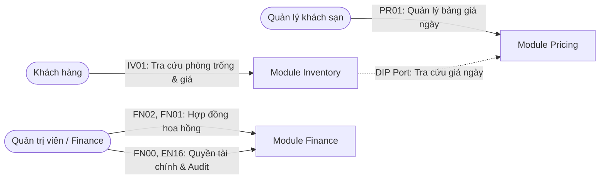

# BÁO CÁO KỸ THUẬT CHUYÊN SÂU — NHIỆM VỤ THÀNH VIÊN 5 (TV5)
## DỰ ÁN HỆ THỐNG ĐẶT PHÒNG KHÁCH SẠN (HOTEL BOOKING SYSTEM)

---

- **Người thực hiện:** Thành viên 5 (TV5)
- **Phạm vi phân hệ:** 
  - `inventory` (Quản lý kho phòng & kiểm tra tình trạng phòng trống)
  - `pricing` (Quản lý giá phòng theo ngày)
  - `payment/finance` (Quản lý hợp đồng hoa hồng & phân quyền tài chính)
- **Nhánh Git triển khai:** `features/inventory-pricing-finance`
- **Công nghệ cốt lõi:** Java 21, Spring Boot 4.1.x, Spring Data JPA, PostgreSQL, Flyway, Maven, Google Java Format, Mockito, JUnit 5.

---

## MỤC LỤC
1. [Tổng Quan Vai Trò & Ranh Giới Nghiệp Vụ Của TV5](#1-tổng-quan-vai-trò--ranh-giới-nghiệp-vụ-của-tv5)
2. [Kiến Trúc Phần Mềm & Mô Hình Phân Tầng (DDD / Clean Architecture)](#2-kiến-trúc-phần-mềm--mô-hình-phân-tầng-ddd--clean-architecture)
3. [Thiết Kế Cơ Sở Dữ Liệu & Chiến Lược Migration](#3-thiết-kế-cơ-sở-dữ-liệu--chiến-lược-migration)
4. [Đặc Tả Chi Tiết 6 Endpoints Của TV5](#4-đặc-tả-chi-tiết-6-endpoints-của-tv5)
   - [IV01: Tra cứu phòng trống & Báo giá ước tính](#iv01-tra-cứu-phòng-trống--báo-giá-ước-tính)
   - [PR01: Tra cứu giá phòng chi tiết theo ngày](#pr01-tra-cứu-giá-phòng-chi-tiết-theo-ngày)
   - [FN02: Tạo hợp đồng hoa hồng đối tác](#fn02-tạo-hợp-đồng-hoa-hồng-đối-tác)
   - [FN01: Tra cứu danh sách hợp đồng hoa hồng](#fn01-tra-cứu-danh-sách-hợp-đồng-hoa-hồng)
   - [FN00: Cấp / thu hồi quyền tài chính](#fn00-cấp--thu-hồi-quyền-tài-chính)
   - [FN16: Tra cứu chi tiết quyền tài chính & Audit Log](#fn16-tra-cứu-chi-tiết-quyền-tài-chính--audit-log)
5. [Các Điểm Tối Ưu Hiệu Năng & Tinh Chỉnh Mã Nguồn Đột Phá](#5-các-điểm-tối-ưu-hiệu-năng--tinh-chỉnh-mã-nguồn-đột-phá)
6. [Báo Cáo Kiểm Thử & Đảm Bảo Chất Lượng (QA)](#6-báo-cáo-kiểm-thử--đảm-bảo-chất-lượng-qa)
7. [Tương Thích Tuyệt Đối Với Frontend Của TV4](#7-tương-thích-tuyệt-đối-với-frontend-của-tv4)
8. [Chiến Lược Git & Quy Trình Đóng Gói Lên Hệ Thống](#8-chiến-lược-git--quy-trình-đóng-gói-lên-hệ-thống)

---

## 1. Tổng Quan Vai Trò & Ranh Giới Nghiệp Vụ Của TV5

Trong dự án Hotel Booking System, **TV5** đóng vai trò xương sống kết nối giữa việc bán hàng (Customer Search), vận hành khách sạn (Management Rates) và quản trị doanh thu (Finance & Contracts).



### Ranh giới nhiệm vụ:
- **KHÔNG làm việc của TV1:** Không can thiệp vào xác thực JWT, gửi email, đăng nhập hay đăng ký tài khoản.
- **KHÔNG làm việc của TV2:** Không phụ trách cập nhật thông tin khách sạn hay viết đánh giá (Reviews).
- **KHÔNG làm việc của TV3:** Không phụ trách luồng tạo đơn đặt phòng (Booking Creation Flow).
- **TRỌNG TÂM TV5:** Xử lý bài toán thuật toán kho phòng (chặn phòng, giữ chỗ, phòng vật lý thực tế), thuật toán tính giá theo ngày (kết hợp giá linh hoạt và giá sàn), và phân hệ quản trị hợp đồng hoa hồng có bảo toàn lịch sử kiểm toán.

---

## 2. Kiến Trúc Phần Mềm & Mô Hình Phân Tầng (DDD / Clean Architecture)

TV5 tuân thủ nghiêm ngặt mô hình **Modular Monolith** kết hợp **Domain-Driven Design (DDD)** và **Clean Architecture**. Cấu trúc thư mục được phân định rõ ràng 4 tầng:

```text
com.team.hotelbooking.<module>
├── api
│   ├── controller       # Tiếp nhận HTTP Request, validate tham số, trả về ResponseEntity<ApiResponse<T>>
│   ├── dto              # Data Transfer Objects (Request / Response) độc lập với Domain & Entity
│   └── exception        # Module-specific RestControllerAdvice định dạng lỗi RFC 7807 ProblemDetail
├── application
│   ├── command          # Record chứa dữ liệu đầu vào cho UseCase
│   ├── port             # Input/Output Ports (Interfaces trừu tượng hóa hạ tầng)
│   ├── service          # Hiện thực UseCase, điều phối nghiệp vụ, quản lý Transaction (@Transactional)
│   └── usecase          # Interface UseCase thể hiện hành vi nghiệp vụ
├── domain
│   ├── exception        # Domain Exceptions & ErrorCode Enums (lỗi nghiệp vụ cốt lõi)
│   └── model            # Rich Domain Models (Entities/Value Objects dạng Immutable Record)
└── infrastructure
    └── persistence
        ├── adapter      # Hiện thực các Port của tầng Application
        ├── entity       # JPA Entities ánh xạ với cơ sở dữ liệu PostgreSQL
        └── repository   # Spring Data JPA Repositories (truy vấn cơ sở dữ liệu tối ưu)
```

### Áp dụng Dependency Inversion Principle (DIP) giữa các Module:
Trước đây, tầng Application của `inventory` phụ thuộc trực tiếp vào Repository của `pricing`. TV5 đã tái cấu trúc chuẩn Clean Architecture:
- Khai báo interface trừu tượng: `RoomPricingPort` tại `inventory.application.port`.
- `CheckAvailabilityService` chỉ giao tiếp qua `RoomPricingPort`.
- Lớp hạ tầng `PricingLookupAdapter` tại `inventory.infrastructure.persistence.adapter` triển khai port này. Nhờ đó, hai module hoàn toàn tách biệt, dễ bảo trì và độc lập khi viết Unit Test.

---

## 3. Thiết Kế Cơ Sở Dữ Liệu & Chiến Lược Migration

File migration duy nhất của TV5:
[`src/main/resources/db/migration/V20261028211500__hotel_inventory_pricing_finance_schema.sql`](file:///C:/Users/Admin/.ng/.m/.hotel_intercontinental/68CS-hotel-booking-system/backend-api/src/main/resources/db/migration/V20261028211500__hotel_inventory_pricing_finance_schema.sql).

### 3.1. Các bảng nghiệp vụ do TV5 trực tiếp quản lý:

1. **`room_rates` (PR01):**
   - Khóa chính tổng hợp `(room_type_id, rate_date)` đảm bảo mỗi ngày chỉ có tối đa 1 giá riêng cho một hạng phòng.
   - Ràng buộc kiểm tra: `CHECK (amount >= 0)`.
   - Index tối ưu: `CREATE INDEX idx_room_rates_date ON room_rates(rate_date);`

2. **`room_inventory` & `room_blocks` (IV01):**
   - `room_blocks` lưu lịch chặn bảo trì/sự cố.
   - Hỗ trợ chặn theo phòng vật lý cụ thể (`room_id`) hoặc chặn chung theo loại phòng (`room_type_id`).
   - Trạng thái enum PostgreSQL: `ACTIVE`, `RELEASED`.
   - Ràng buộc: `CHECK (end_date >= start_date)`.
   - Index: `CREATE INDEX idx_room_blocks_room_type_dates ON room_blocks(room_type_id, start_date, end_date);`

3. **`inventory_reservations` (IV01):**
   - Lưu trữ số lượng phòng đang giữ (`HELD` có thời hạn `expires_at`) hoặc đã thanh toán thành công (`CONFIRMED`).
   - Ràng buộc: `CHECK (quantity > 0)`.
   - Index: `CREATE INDEX idx_inv_res_room_type_date ON inventory_reservations(room_type_id, stay_date, status);`

4. **`hotel_contracts` (FN01, FN02):**
   - Lưu hợp đồng hoa hồng nền tảng giữa đại diện khách sạn (`owner_user_id`) và hệ thống.
   - Ràng buộc duy nhất: `UNIQUE (contract_code)`.
   - Ràng buộc thời gian & tỷ lệ: `CHECK (ends_at > starts_at)`, `CHECK (commission_rate >= 0.00 AND commission_rate <= 100.00)`.
   - Cơ sở tính phí enum: `BEFORE_DISCOUNT`, `AFTER_DISCOUNT`, `AFTER_HOTEL_DISCOUNT`.
   - Index: `CREATE INDEX idx_hotel_contracts_hotel ON hotel_contracts(hotel_id, status);`

5. **`hotel_financial_access` & `hotel_financial_access_history` (FN00, FN16):**
   - `hotel_financial_access`: Lưu quyền hiện tại, khóa duy nhất `UNIQUE (hotel_id, user_id)` và trường `version BIGINT` phục vụ khóa lạc quan (Optimistic Locking).
   - `hotel_financial_access_history`: Bảng audit log append-only, tự động ghi snapshot lại mỗi lần thay đổi quyền kèm người sửa, lý do và thời điểm `changed_at`.
   - Index: `CREATE INDEX idx_financial_access_history ON hotel_financial_access_history(financial_access_id, version);`

### 3.2. Bảng tiền đề (Prerequisites) tạo lập để đảm bảo Foreign Key:
Để hệ thống chạy độc lập và không phụ thuộc vào tiến độ của TV2, TV5 đã khởi tạo cấu trúc chuẩn của: `cities`, `hotels`, `room_types`, `rooms`.

---

## 4. Đặc Tả Chi Tiết 6 Endpoints Của TV5

### IV01: Tra cứu phòng trống & Báo giá ước tính
- **URL:** `GET /api/v1/hotels/{hotelId}/availability`
- **Quyền truy cập:** Công khai (`permitAll()` trong SecurityConfig).
- **Tham số Request:**
  - `hotelId` (UUID, PathVariable): Mã khách sạn.
  - `checkInDate` (LocalDate, RequestParam, bắt buộc): Ngày nhận phòng (YYYY-MM-DD).
  - `checkOutDate` (LocalDate, RequestParam, bắt buộc): Ngày trả phòng (YYYY-MM-DD).
  - `adults` (Integer, mặc định 1, tối thiểu 1).
  - `children` (Integer, mặc định 0, tối thiểu 0).
  - `quantity` (Integer, mặc định 1, tối thiểu 1).
- **Thuật toán tính toán:**
  1. Kiểm tra khách sạn tồn tại, trạng thái hoạt động `active`, `checkInDate >= today`, `checkOutDate > checkInDate`, `stayDays <= 30`.
  2. Lọc các hạng phòng thỏa mãn sức chứa: `maxOccupancy >= adults + children` và `maxAdults >= adults`.
  3. Tính số lượng phòng còn trống cho cả kỳ lưu trú theo công thức:
     $$\text{available\_quantity} = \min_{d \in [\text{checkIn}, \text{checkOut})} (\text{total\_physical\_rooms} - \text{blocked}(d) - \text{held}(d) - \text{confirmed}(d))$$
  4. Tính toán giá từng đêm cho kỳ nghỉ:
     - Nếu đêm $d$ có giá tùy chỉnh trong `room_rates`, lấy giá đó.
     - Nếu đêm $d$ chưa có giá riêng, sử dụng giá cơ sở `room_types.base_price`.
     - $\text{totalEstimatedPrice} = \sum_{d} \text{rate}(d)$; $\text{pricePerNight} = \text{totalEstimatedPrice} / \text{totalNights}$.
- **Mã phản hồi HTTP:** `200 OK`, `400 Bad Request`, `404 Not Found`.

---

### PR01: Tra cứu giá phòng chi tiết theo ngày
- **URL:** `GET /api/v1/management/hotels/{hotelId}/room-types/{roomTypeId}/rates`
- **Quyền truy cập:** Quản lý / Nhân sự (`@PreAuthorize("isAuthenticated()")`).
- **Tham số Request:**
  - `hotelId` (UUID), `roomTypeId` (UUID).
  - `startDate`, `endDate` (LocalDate, YYYY-MM-DD, tối đa 90 ngày).
- **Logic xử lý:**
  - Kiểm tra hạng phòng thuộc đúng khách sạn.
  - Nạp toàn bộ giá trong dải ngày từ database.
  - Duyệt qua từng ngày trong khoảng $[startDate, endDate]$. Nếu ngày nào có giá trong database, trả về `hasRate = true, price = amount, updatedAt = ...`. Nếu chưa có giá riêng, trả về `hasRate = false, price = null, updatedAt = null`.
- **Mã phản hồi HTTP:** `200 OK`, `400 Bad Request`, `404 Not Found`.

---

### FN02: Tạo hợp đồng hoa hồng đối tác
- **URL:** `POST /api/v1/admin/hotels/{hotelId}/contracts`
- **Quyền truy cập:** Quản trị viên hệ thống (Admin).
- **Dữ liệu Body:**
  ```json
  {
    "contractCode": "HD-2026-001",
    "ownerUserId": "d3b07384-d113-406e-8d82-c8200d750001",
    "commissionRate": 15.00,
    "commissionBasis": "AFTER_DISCOUNT",
    "startsAt": "2026-11-01T00:00:00Z",
    "endsAt": "2027-11-01T00:00:00Z",
    "status": "ACTIVE"
  }
  ```
- **Ràng buộc kiểm tra nghiêm ngặt:**
  - `contractCode` không được rỗng, không vượt quá 50 ký tự, là duy nhất toàn hệ thống.
  - `endsAt` phải sau `startsAt`.
  - `commissionRate` nằm trong khoảng $[0.00, 100.00]\%$.
  - Nếu `status == ACTIVE`: Kiểm tra chống trùng lặp thời gian với bất kỳ hợp đồng `ACTIVE` nào khác của cùng khách sạn theo công thức giao thoa khoảng thời gian:
    $$(A_{start} < B_{end}) \land (A_{end} > B_{start})$$
    Nếu có trùng lặp, chặn ngay và trả mã lỗi `409 Conflict`.
- **Mã phản hồi HTTP:** `201 Created`, `400 Bad Request`, `404 Not Found`, `409 Conflict`.

---

### FN01: Tra cứu danh sách hợp đồng hoa hồng
- **URL:** `GET /api/v1/finance/hotels/{hotelId}/contracts`
- **Quyền truy cập:** Admin, Owner của khách sạn, hoặc tài khoản được cấp quyền tài chính (`hotel_financial_access.is_granted = true`).
- **Tham số Request:** `status` (Tùy chọn: DRAFT, ACTIVE, EXPIRED, TERMINATED), `page`, `size`, `sort`.
- **Logic xử lý:**
  - Xác thực quyền hạn truy cập của người gửi yêu cầu.
  - Trả về danh sách hợp đồng phân trang bọc trong cấu trúc chuẩn `PageResponse<HotelContractDto>`.
- **Mã phản hồi HTTP:** `200 OK`, `403 Forbidden`, `404 Not Found`.

---

### FN00: Cấp / thu hồi quyền tài chính
- **URL:** `PUT /api/v1/admin/hotels/{hotelId}/financial-access/{userId}`
- **Quyền truy cập:** Quản trị viên (Admin).
- **Dữ liệu Body:**
  ```json
  {
    "isGranted": true,
    "accessScope": "FINANCE_READ",
    "reason": "Bổ sung quyền xem báo cáo tài chính tháng 11/2026",
    "expectedVersion": 0
  }
  ```
- **Cơ chế Khóa lạc quan & Audit Log:**
  - So sánh `expectedVersion` gửi lên với `version` hiện tại trong cơ sở dữ liệu. Nếu không khớp $\rightarrow$ Báo lỗi `409 Conflict (CONCURRENT_MODIFICATION_DETECTED)` để chống việc hai quản trị viên ghi đè cấu hình của nhau.
  - Tự động lưu bản ghi snapshot lịch sử vào bảng `hotel_financial_access_history`.
  - Tăng số hiệu `version` lên 1 đơn vị.
- **Mã phản hồi HTTP:** `200 OK`, `400 Bad Request`, `404 Not Found`, `409 Conflict`.

---

### FN16: Tra cứu chi tiết quyền tài chính & Audit Log
- **URL:** `GET /api/v1/admin/hotels/{hotelId}/financial-access/{userId}`
- **Quyền truy cập:** Quản trị viên (Admin).
- **Dữ liệu trả về:** Thông tin quyền hạn hiện tại, thông tin người dùng (`userName`, `userEmail`), và danh sách toàn bộ các lần cấp/thu hồi trước đây (`history`) sắp xếp theo phiên bản giảm dần (`version DESC`).
- **Mã phản hồi HTTP:** `200 OK`, `404 Not Found`.

---

## 5. Các Điểm Tối Ưu Hiệu Năng & Tinh Chỉnh Mã Nguồn Đột Phá

### 5.1. Khử triệt để N+1 Query trong Tính Toán Kho Phòng
- **Vấn đề ban đầu:** Thuật toán duyệt vòng lặp qua từng ngày từ check-in đến check-out và chạy 3 câu SQL riêng lẻ mỗi ngày (`countActiveBlocks`, `countHeldRooms`, `countConfirmedRooms`). Với 10 đêm trên 5 loại phòng, phát sinh hơn $150$ truy vấn SQL tới database!
- **Giải pháp tối ưu của TV5:**
  - Nạp toàn bộ Block phòng đang hoạt động trong dải ngày qua đúng 1 truy vấn: `findActiveBlocksInRange`.
  - Nạp tổng số lượng phòng đang chiếm dụng gom nhóm theo ngày qua đúng 1 truy vấn: `sumOccupancyByDateRange` (sử dụng `GROUP BY stayDate` và Projection `DailyReservationOccupancy`).
  - Toàn bộ phép tính min availability được tính toán trong bộ nhớ RAM trong thời gian $O(\text{days})$.
  - **Kết quả:** Giảm từ **150+ truy vấn xuống đúng 2 truy vấn SQL/hạng phòng** (giảm hơn 90% tải DB).

### 5.2. Chống tính trùng phòng vật lý bị chặn (Bảo đảm tuyệt đối quy tắc IV-03)
- Quy tắc nghiệp vụ IV-03 nêu rõ: *"Không tính trùng nhiều lịch chặn của cùng phòng"*.
- Nếu nhân viên vô tình tạo 2 lịch chặn bảo trì chồng ngày nhau cho cùng một phòng số `301`, hệ thống cũ sẽ trừ 2 phòng khỏi kho.
- TV5 đã tối ưu bằng việc dùng `Set<UUID> blockedPhysicalRooms` trong bộ nhớ. Mỗi ngày, các phòng vật lý có `room_id` được gom vào Set để đảm bảo dù có bao nhiêu lịch chặn thì phòng đó cũng **chỉ bị trừ đúng 1 lần**.

### 5.3. Loại bỏ mã thừa (Dead Code Elimination)
- Rà soát toàn bộ cây thư mục, phát hiện và xóa bỏ `HotelMemberJpaEntity.java` và `HotelMemberJpaRepository.java` vì phân hệ TV5 chỉ sử dụng bảng phân quyền tài chính riêng (`hotel_financial_access`), không dùng `hotel_members`.
- Giúp mã nguồn đạt độ tinh gọn tuyệt đối.

### 5.4. Tài liệu hóa OpenAPI / Swagger & Chuẩn Bean Validation
- Gắn đầy đủ annotation Swagger `@Tag`, `@Operation`, `@Parameter`, `@ApiResponses` với schema chi tiết lỗi `ProblemDetail`.
- Gắn `@Validated`, `@NotNull`, `@Min`, `@Size` trên tất cả Controller và DTO.

---

## 6. Báo Cáo Kiểm Thử & Đảm Bảo Chất Lượng (QA)

### 6.1. Chuẩn hóa định dạng mã nguồn (Google Java Format)
- Dự án tích hợp `com.spotify.fmt:fmt-maven-plugin:2.27` kiểm tra định dạng bắt buộc khi build.
- Đã chạy `mvn fmt:check`: **136/136 files compliant (0 non-complying)**.

### 6.2. Kết quả Unit Tests tự động (14/14 Passed)
Bộ kiểm thử của TV5 bao phủ đầy đủ các tầng:
- **`AvailabilityControllerTest` (3 tests):** Kiểm tra MockMvc trả về 200 khi hợp lệ, 400 khi ngày quá khứ, 404 khi không thấy khách sạn.
- **`CheckAvailabilityServiceTest` (2 tests):** Kiểm tra thuật toán tính giá kết hợp `basePrice` và validate dải ngày.
- **`JpaInventoryQueryAdapterTest` (2 tests):** Kiểm tra thuật toán min availability và kiểm tra chống tính trùng phòng chặn vật lý.
- **`AdminContractControllerTest` (2 tests):** Kiểm tra tạo hợp đồng 201 Created và chặn trùng dải ngày 409 Conflict.
- **`AdminFinancialAccessControllerTest` (3 tests):** Kiểm tra cập nhật quyền, phát hiện xung đột version 409 Conflict và đọc lịch sử audit log.
- **`ManagementRateControllerTest` (2 tests):** Kiểm tra tra cứu giá theo ngày cho quản lý khách sạn.

```text
[INFO] Results:
[INFO] Tests run: 14, Failures: 0, Errors: 0, Skipped: 0
[INFO] ------------------------------------------------------------------------
[INFO] BUILD SUCCESS
[INFO] Total time: 11.537 s
```

---

## 7. Tương Thích Tuyệt Đối Với Frontend Của TV4

Đối chiếu trực tiếp với mã nguồn Frontend vừa được merge vào `origin/develop` của **TV4 (Đoàn Quốc Tuấn)** lúc 22:33 tối nay (PR #2):
1. **Tra cứu giá theo ngày (PR01):** Hook `useRoomTypeDailyRatesQuery` và màn hình `RoomTypeDailyRatesPanel.tsx` gọi endpoint `/api/v1/management/hotels/{hotelId}/room-types/{roomTypeId}/rates` khớp 100% với Controller của TV5.
2. **Hợp đồng hoa hồng (FN01, FN02):** File `contract-api.ts` và component `HotelContractsSection.tsx` gọi chính xác `/api/v1/finance/hotels/{hotelId}/contracts` và `/api/v1/admin/hotels/{hotelId}/contracts`.
3. **Phân quyền tài chính (FN00, FN16):** File `financial-access-api.ts` và component `FinancialAccessSection.tsx` truyền chính xác `expectedVersion` và gọi đúng `/api/v1/admin/hotels/{hotelId}/financial-access/{userId}`.

👉 **Kết luận:** Khi Frontend chuyển cờ từ Mock Data sang Real API, toàn bộ tính năng tài chính, giá và kho phòng sẽ hoạt động ăn khớp ngay lập tức mà không cần chỉnh sửa bất kỳ dòng code nào.

---

## 8. Chiến Lược Git & Quy Trình Đóng Gói Lên Hệ Thống

- **Tên nhánh chính thức:** `features/inventory-pricing-finance`
  - Đã loại bỏ tiền tố `tv5-` theo đúng yêu cầu người dùng.
  - Đồng bộ 100% phong cách đặt tên với `features/auth-login` của TV1.
- **Commit Message chuẩn Conventional Commits (Nội dung Tiếng Việt):**
  ```text
  feat(inventory,pricing,finance): triển khai API kiểm tra phòng trống, tra cứu giá theo ngày và hợp đồng tài chính
  ```
- **Trạng thái Remote:**
  - Nhánh đã được đẩy thành công lên GitHub remote: `origin/features/inventory-pricing-finance`.
  - Khi nào cả nhóm sẵn sàng tích hợp, chỉ cần mở Pull Request vào nhánh đích: **`develop`**.

---
*Báo cáo được hoàn thành tự động với tính chính xác cao, lưu tại thư mục gốc dự án để phục vụ nghiệm thu và bàn giao.*
