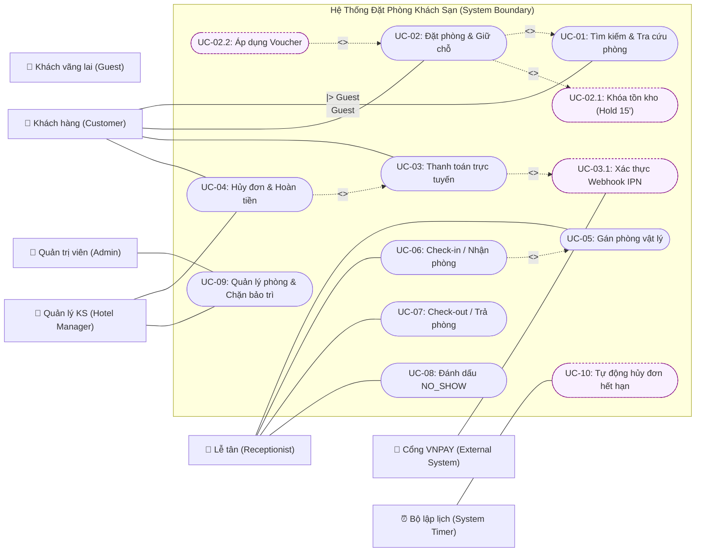
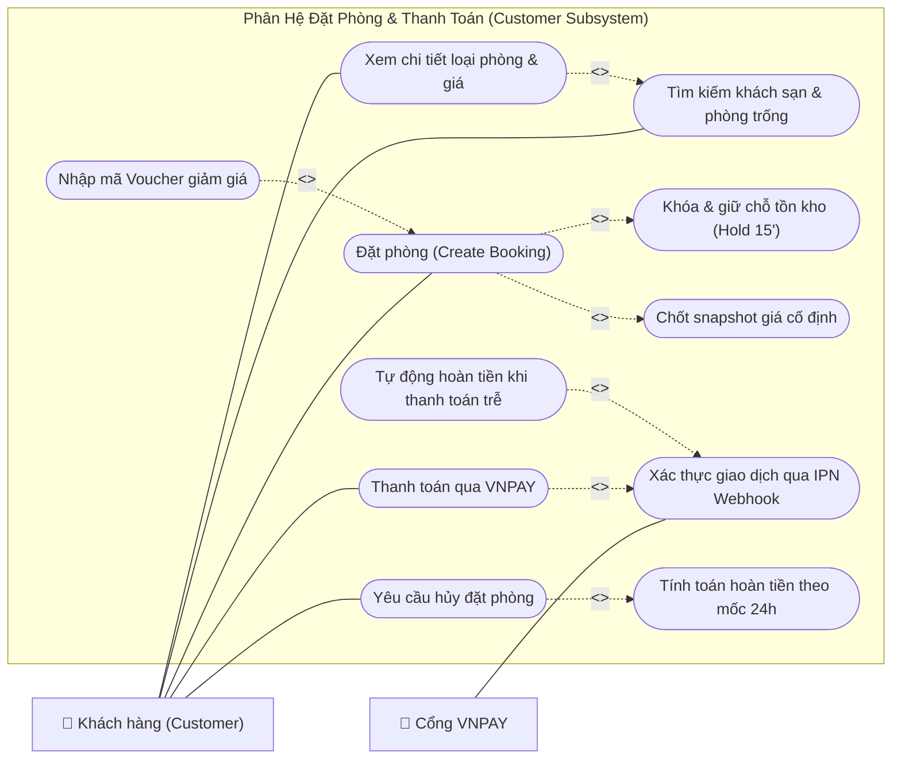
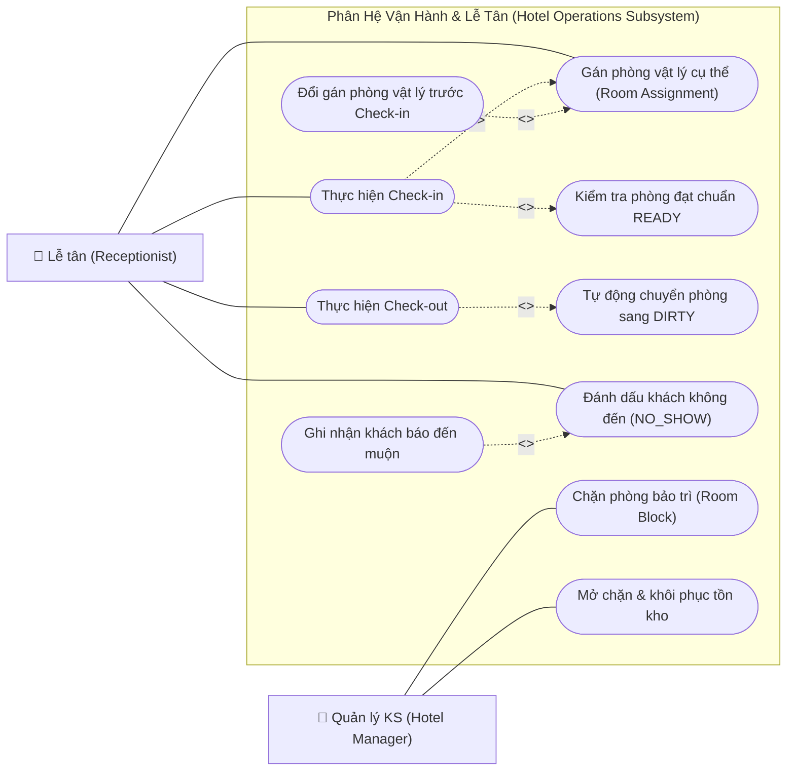

# Sơ Đồ Use Case Chuẩn UML (Hotel Booking System)

> **Quy chuẩn thiết kế:** Tuân thủ 100% chuẩn **UML 2.5** (tương đương mô hình vẽ trên Draw.io / StarUML):
> - **Use Case:** Biểu diễn bằng hình Oval / Elip `([ ... ])`.
> - **Actor:** Nằm ngoài đường biên hệ thống (System Boundary).
> - **Association (Liên kết):** Đường nét liền (`---`) giữa Actor và Use Case.
> - **`<<include>>`:** Quan hệ bắt buộc (mũi tên nét đứt hướng từ Use Case cơ sở đến Use Case được bao hàm).
> - **`<<extend>>`:** Quan hệ mở rộng/tùy chọn (mũi tên nét đứt kèm điểm mở rộng Extension Point).
> - **Generalization:** Quan hệ kế thừa giữa các Actor (`Customer` kế thừa `Guest`).

---

## 1. Sơ Đồ Use Case Tổng Quan (UML Standard Diagram)

---

## 2. Sơ Đồ Phân Rã Chi Tiết Cho Từng Phân Hệ Cốt Lõi

---

### Phân hệ A: Khách hàng — Tra cứu, Đặt phòng & Thanh toán

Sơ đồ thể hiện đầy đủ quan hệ **`<<include>>`** (các điều kiện bắt buộc) và **`<<extend>>`** (các luồng tùy chọn mở rộng):

---

### Phân hệ B: Lễ tân & Quản lý — Điều phối phòng, Check-in & Bảo trì

Sơ đồ thể hiện nghiệp vụ nội bộ khách sạn giữa Lễ tân và Quản trị:

---

## 3. Bảng Đặc Tả Ý Nghĩa Các Mối Quan Hệ Chuẩn UML

| Quan hệ | Use Case nguồn | Use Case đích | Ý nghĩa nghiệp vụ thực tế |
|---|---|---|---|
| **`<<include>>`** | Đặt phòng (`UC-02`) | Khóa tồn kho 15' (`UC-02.1`) | **Bắt buộc:** Không thể tạo đơn nếu hệ thống không đồng thời giữ được chỗ trên kho phòng. |
| **`<<include>>`** | Thanh toán (`UC-03`) | Xác thực IPN (`UC-03.1`) | **Bắt buộc:** Đơn chỉ được xác nhận thành công thông qua Webhook IPN có ký số hợp lệ từ VNPAY. |
| **`<<include>>`** | Check-in (`UC-06`) | Gán phòng vật lý (`UC-05`) | **Bắt buộc:** Khách không thể nhận chìa khóa/check-in nếu lễ tân chưa gán số phòng cụ thể. |
| **`<<include>>`** | Check-in (`UC-06`) | Kiểm tra phòng READY | **Bắt buộc:** Chỉ phòng đã dọn dẹp sạch sẽ mới được phép check-in cho khách. |
| **`<<include>>`** | Check-out (`UC-07`) | Đổi phòng sang DIRTY | **Bắt buộc:** Khi khách trả phòng, trạng thái buồng phòng lập tức chuyển về chưa dọn (`DIRTY`). |
| **`<<extend>>`** | Áp dụng Voucher | Đặt phòng (`UC-02`) | **Tùy chọn:** Khách có thể nhập hoặc không nhập mã giảm giá khi đặt phòng. |
| **`<<extend>>`** | Tự động hoàn tiền trễ | Xác thực IPN | **Ngoại lệ:** Chỉ kích hoạt khi tiền thanh toán thành công gửi về sau khi đơn đã bị hủy/hết hạn. |
| **`<<extend>>`** | Ghi nhận đến muộn | Đánh dấu NO_SHOW | **Tùy chọn/Ngoại lệ:** Nếu khách có gọi điện báo muộn, hệ thống ngăn chặn việc đánh dấu NO_SHOW theo mốc mặc định. |
| **`Generalization`** | Khách hàng (`Customer`) | Khách vãng lai (`Guest`) | **Kế thừa:** Khách hàng có tài khoản kế thừa toàn bộ quyền tra cứu của khách vãng lai. |
