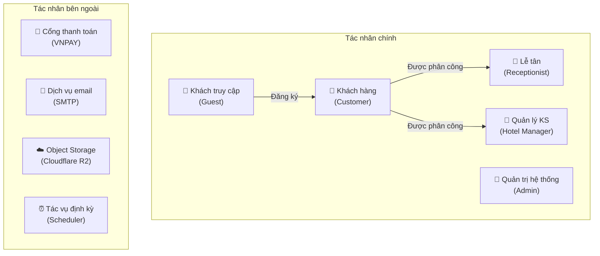
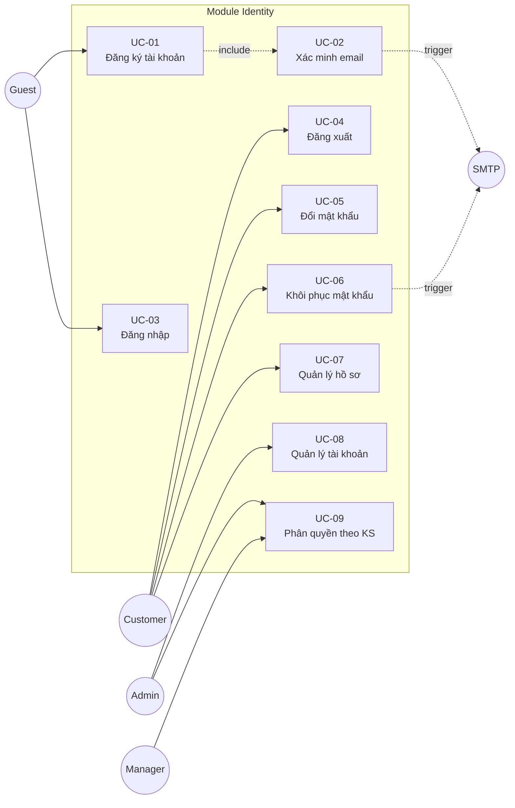
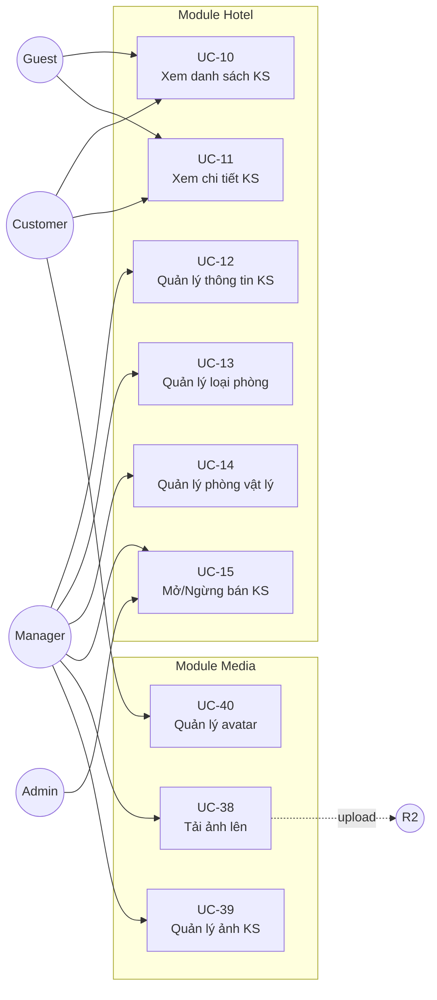
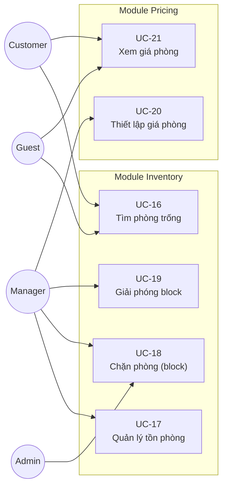
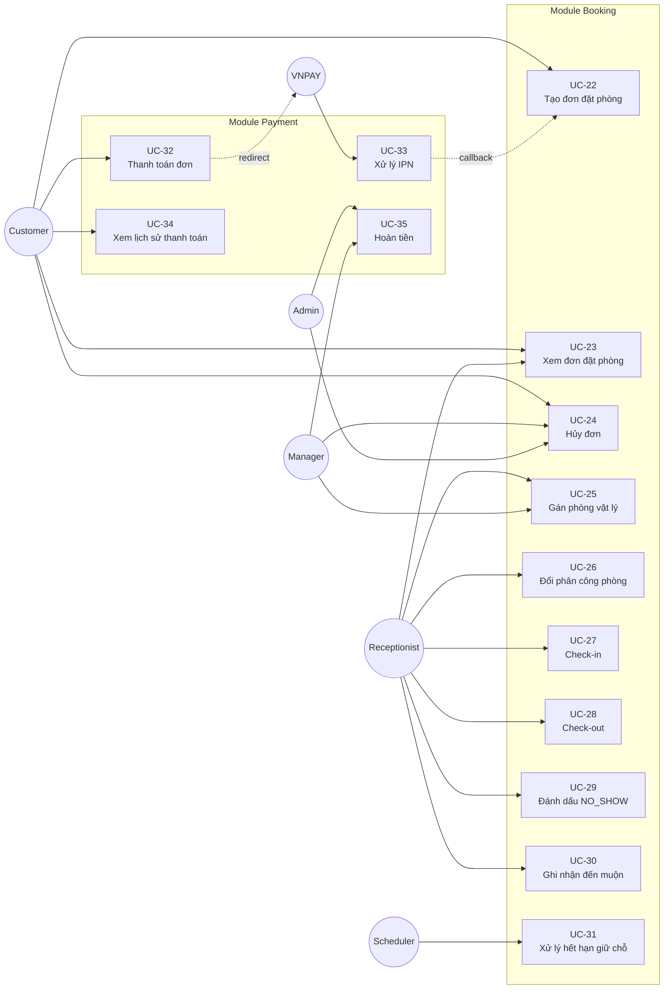
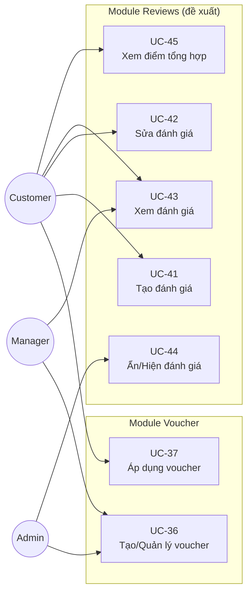

# Đặc tả Use Case — Hệ thống Hotel Booking

> **Phiên bản:** v1.0 — Ngày 22/10/2026
>
> **Nguồn phân tích:**
> - [Phạm vi và quy tắc nghiệp vụ](file:///c:/Users/Admin/Downloads/business/module-scope-and-rules-draft.md)
> - [Đối chiếu database](file:///c:/Users/Admin/Downloads/business/database-fit-review.md)
> - [Database README](file:///c:/Users/Admin/Downloads/database/README.md)
> - [Quy tắc dữ liệu](file:///c:/Users/Admin/Downloads/database/business-rules.md)
> - [ERD](file:///c:/Users/Admin/Downloads/database/erd.md)
> - [Từ điển dữ liệu](file:///c:/Users/Admin/Downloads/database/data-dictionary.md)
> - [Luồng hoạt động](file:///c:/Users/Admin/Downloads/hotel-booking-luong-hoat-dong/luong-hoat-dong.md)

---

## Mục lục

1. [Tổng quan hệ thống](#1-tổng-quan-hệ-thống)
2. [Tác nhân (Actors)](#2-tác-nhân-actors)
3. [Sơ đồ Use Case tổng thể](#3-sơ-đồ-use-case-tổng-thể)
4. [Use Case — Identity](#4-use-case--identity)
5. [Use Case — Hotel](#5-use-case--hotel)
6. [Use Case — Inventory](#6-use-case--inventory)
7. [Use Case — Pricing](#7-use-case--pricing)
8. [Use Case — Booking](#8-use-case--booking)
9. [Use Case — Payment](#9-use-case--payment)
10. [Use Case — Media](#10-use-case--media)
11. [Use Case — Voucher / Promotions](#11-use-case--voucher--promotions)
12. [Use Case — Reviews](#12-use-case--reviews)
13. [Ma trận Actor – Use Case](#13-ma-trận-actor--use-case)
14. [Bảng truy vết Use Case – Quy tắc nghiệp vụ](#14-bảng-truy-vết-use-case--quy-tắc-nghiệp-vụ)

---

## 1. Tổng quan hệ thống

Hệ thống đặt phòng khách sạn trực tuyến đa khách sạn. Khách tìm khách sạn, xem phòng còn trống và giá theo ngày, đặt phòng theo loại phòng và số lượng, thanh toán trực tuyến, theo dõi đơn và hủy theo chính sách. Nhân sự quản lý phòng vật lý, gán phòng cụ thể và tiếp nhận khách.

**Kiến trúc:** Spring Boot Modular Monolith · PostgreSQL (37 bảng) · React/Vite · VNPAY · Cloudflare R2

**Phạm vi:** 9 module — Identity, Hotel, Inventory, Pricing, Booking, Payment, Media, Voucher, Reviews (đề xuất)

---

## 2. Tác nhân (Actors)



| Tác nhân | Mô tả | Giới hạn |
|---|---|---|
| **Khách truy cập (Guest)** | Người dùng chưa đăng nhập, xem thông tin công khai | Chỉ xem; không đặt phòng, không xem dữ liệu riêng |
| **Khách hàng (Customer)** | Đã đăng ký, đăng nhập, xác minh email | Chỉ tạo đơn khi email đã xác minh; chỉ xem/hủy đơn của mình |
| **Lễ tân (Receptionist)** | Nhân viên tại khách sạn được giao | Chỉ thao tác tại khách sạn mình; không chỉnh giá, không cấp quyền |
| **Quản lý KS (Hotel Manager)** | Quản lý khách sạn được phân công | Không quản lý KS khác; không tự cấp quyền admin |
| **Quản trị (Admin)** | Quản trị viên toàn hệ thống | Can thiệp có lý do và truy vết; không vượt giới hạn tồn phòng |
| **Cổng thanh toán (VNPAY)** | Hệ thống bên ngoài | Chỉ báo kết quả thu/hoàn; không quản lý dữ liệu nghiệp vụ |
| **Dịch vụ email (SMTP)** | Hệ thống bên ngoài | Gửi email xác minh và reset password |
| **Scheduler** | Tác vụ nền trong backend | Xử lý hết hạn giữ chỗ; không tự đánh dấu NO_SHOW |

> [!NOTE]
> Một tài khoản có thể đồng thời là Customer và nhân sự (Receptionist/Manager). Quyền nhân sự luôn gắn với từng khách sạn cụ thể.

---

## 3. Sơ đồ Use Case tổng thể

### 3.1. Identity & Hotel



### 3.2. Hotel & Media



### 3.3. Inventory & Pricing



### 3.4. Booking & Payment



### 3.5. Voucher & Reviews



---

## 4. Use Case — Identity

### UC-01: Đăng ký tài khoản

| Thuộc tính | Nội dung |
|---|---|
| **UC-ID** | UC-01 |
| **Tên** | Đăng ký tài khoản |
| **Tác nhân** | Khách truy cập (Guest) |
| **Mô tả** | Người dùng tạo tài khoản mới bằng email, mật khẩu, tên và số điện thoại để có thể đặt phòng |
| **Quy tắc** | ID-01, ID-02, ID-09, ID-10 |

**Điều kiện tiên quyết:**
- Email chưa tồn tại trong hệ thống (so sánh case-insensitive, bỏ khoảng trắng đầu/cuối)

**Luồng chính (Basic Flow):**
1. Người dùng truy cập trang đăng ký
2. Người dùng nhập email, mật khẩu, tên đầy đủ, số điện thoại
3. Hệ thống chuẩn hóa email (lowercase, trim)
4. Hệ thống kiểm tra email và SĐT chưa tồn tại
5. Hệ thống lưu tài khoản với status = `pending`, email_verified_at = NULL
6. Hệ thống chỉ gán quyền CUSTOMER
7. Hệ thống tạo token xác minh email có thời hạn
8. Hệ thống gửi URL xác minh qua email (trigger UC-02)
9. Hiển thị thông báo đăng ký thành công, yêu cầu kiểm tra email

**Luồng thay thế:**
- **3a.** Email đã tồn tại → Thông báo "email đã được sử dụng"
- **3b.** SĐT đã tồn tại → Thông báo "số điện thoại đã được sử dụng"

**Luồng ngoại lệ:**
- **2a.** Thiếu trường bắt buộc → Hiển thị lỗi validation cụ thể
- **8a.** Gửi email thất bại → Tài khoản vẫn được tạo, cho yêu cầu gửi lại

**Hậu điều kiện:**
- Tài khoản được tạo, chưa xác minh email
- Tài khoản chỉ có quyền CUSTOMER, không có quyền Manager/Admin
- Token xác minh email được tạo và gửi

---

### UC-02: Xác minh email

| Thuộc tính | Nội dung |
|---|---|
| **UC-ID** | UC-02 |
| **Tên** | Xác minh email một lần |
| **Tác nhân** | Khách hàng (Customer) |
| **Mô tả** | Xác minh quyền sở hữu email bằng URL chứa mã xác minh, chỉ cần thực hiện một lần |
| **Quy tắc** | ID-09, ID-10, ID-11 |

**Điều kiện tiên quyết:**
- Tài khoản đã đăng ký, email chưa xác minh
- Token xác minh hợp lệ (chưa hết hạn, chưa dùng, chưa bị thu hồi)

**Luồng chính:**
1. Người dùng mở URL xác minh từ email
2. Hệ thống trích xuất token từ URL
3. Hệ thống kiểm tra hash token, thời hạn, trạng thái đã dùng/thu hồi
4. Token hợp lệ → Ghi `email_verified_at` = thời điểm hiện tại
5. Đánh dấu token đã dùng (one-time use)
6. Thông báo xác minh thành công, cho phép đặt phòng

**Luồng thay thế:**
- **3a.** Token hết hạn → Thông báo hết hạn, hướng dẫn yêu cầu gửi lại
- **3b.** Token đã dùng → Thông báo đã xác minh, không cần làm lại
- **6a.** Gửi lại email xác minh → Tạo token mới, không tạo tài khoản mới (ID-09)

**Luồng ngoại lệ:**
- **3c.** Token reset password dùng cho endpoint xác minh → Từ chối, hai mục đích riêng (ID-11)

**Hậu điều kiện:**
- email_verified_at ≠ NULL → Các lần đăng nhập sau không cần xác minh lại
- Đặt phòng được phép

---

### UC-03: Đăng nhập

| Thuộc tính | Nội dung |
|---|---|
| **UC-ID** | UC-03 |
| **Tên** | Đăng nhập |
| **Tác nhân** | Guest → Customer/Receptionist/Manager/Admin |
| **Mô tả** | Xác thực bằng email/mật khẩu, tạo phiên làm việc |
| **Quy tắc** | ID-04, ID-10 |

**Luồng chính:**
1. Nhập email và mật khẩu
2. Hệ thống chuẩn hóa email và xác thực
3. Kiểm tra tài khoản không bị khóa (status ≠ `banned`)
4. Tạo phiên (access token + refresh token)
5. Trả kết quả đăng nhập thành công

**Luồng thay thế:**
- **2a.** Sai email/mật khẩu → Thông báo lỗi chung (không chỉ rõ trường nào sai)
- **3a.** Tài khoản bị khóa → Từ chối đăng nhập, thông báo tài khoản bị khóa (ID-04)
- **5a.** Email chưa xác minh → Đăng nhập thành công nhưng giới hạn: được xem thông tin công khai, không được tạo đơn (ID-10)

---

### UC-04: Đăng xuất

| Thuộc tính | Nội dung |
|---|---|
| **UC-ID** | UC-04 |
| **Tên** | Đăng xuất |
| **Tác nhân** | Customer / Receptionist / Manager / Admin |
| **Mô tả** | Kết thúc phiên đăng nhập |

**Luồng chính:**
1. Người dùng chọn đăng xuất
2. Hệ thống vô hiệu hóa refresh token hiện tại
3. Chuyển về trang đăng nhập

---

### UC-05: Đổi mật khẩu

| Thuộc tính | Nội dung |
|---|---|
| **UC-ID** | UC-05 |
| **Tên** | Đổi mật khẩu |
| **Tác nhân** | Customer / Receptionist / Manager / Admin |
| **Mô tả** | Thay đổi mật khẩu khi đang đăng nhập, yêu cầu mật khẩu hiện tại |
| **Quy tắc** | ID-06 |

**Luồng chính:**
1. Nhập mật khẩu hiện tại và mật khẩu mới
2. Hệ thống xác thực mật khẩu hiện tại
3. Cập nhật password_hash

**Luồng thay thế:**
- **2a.** Mật khẩu hiện tại sai → Từ chối

---

### UC-06: Khôi phục mật khẩu

| Thuộc tính | Nội dung |
|---|---|
| **UC-ID** | UC-06 |
| **Tên** | Khôi phục mật khẩu (Quên mật khẩu) |
| **Tác nhân** | Guest / Customer |
| **Mô tả** | Đặt lại mật khẩu qua URL gửi đến email đã đăng ký |
| **Quy tắc** | ID-06, ID-07, ID-11 |

**Luồng chính:**
1. Nhập email đã đăng ký
2. Hệ thống tạo token reset có thời hạn (đề xuất 15 phút)
3. Gửi URL đặt lại mật khẩu qua email
4. Người dùng mở URL, nhập mật khẩu mới
5. Hệ thống kiểm tra token hợp lệ (hash, hạn, dùng một lần)
6. Cập nhật mật khẩu, vô hiệu hóa token
7. Vô hiệu hóa các phiên đăng nhập trước đó (ID-07)

**Luồng thay thế:**
- **5a.** Token hết hạn → Từ chối, yêu cầu gửi lại
- **5b.** Token đã dùng → Từ chối

**Luồng ngoại lệ:**
- **7a.** Reset password KHÔNG tự xác minh email (ID-11): nếu email chưa xác minh, email_verified_at vẫn NULL sau reset

---

### UC-07: Quản lý hồ sơ cá nhân

| Thuộc tính | Nội dung |
|---|---|
| **UC-ID** | UC-07 |
| **Tên** | Quản lý hồ sơ cá nhân |
| **Tác nhân** | Customer |
| **Mô tả** | Xem và sửa tên, SĐT (email không đổi trong bản đầu) |
| **Quy tắc** | ID-05, ID-07 |

**Luồng chính:**
1. Xem hồ sơ hiện tại
2. Sửa tên / SĐT
3. Hệ thống cập nhật

**Hậu điều kiện:**
- Thông tin đơn cũ giữ snapshot lúc đặt, không bị ảnh hưởng (ID-05)

---

### UC-08: Quản lý tài khoản (Admin)

| Thuộc tính | Nội dung |
|---|---|
| **UC-ID** | UC-08 |
| **Tên** | Quản lý tài khoản |
| **Tác nhân** | Admin |
| **Mô tả** | Xem danh sách tài khoản, khóa/mở tài khoản |
| **Quy tắc** | ID-04, ID-08 |

**Luồng chính:**
1. Admin tìm tài khoản
2. Khóa hoặc mở khóa tài khoản với lý do
3. Ghi nhận người thực hiện và thời điểm

**Luồng ngoại lệ:**
- Không xóa tài khoản có lịch sử đơn/giao dịch → chỉ khóa (ID-08)

---

### UC-09: Phân quyền theo khách sạn

| Thuộc tính | Nội dung |
|---|---|
| **UC-ID** | UC-09 |
| **Tên** | Phân quyền nhân sự theo khách sạn |
| **Tác nhân** | Admin, Manager |
| **Mô tả** | Gán/thu hồi vai trò Receptionist/Manager tại từng khách sạn |
| **Quy tắc** | ID-03 |

**Luồng chính:**
1. Admin phân công Manager cho khách sạn X
2. Manager phân công/thu hồi Receptionist tại khách sạn X

**Luồng thay thế:**
- Manager KHÔNG được phân công Manager khác (chỉ Admin)
- Manager KHÔNG được tự cấp quyền Admin

**Hậu điều kiện:**
- Quyền nhân sự luôn gắn hotel_id cụ thể
- Manager hotel A không có quyền tại hotel B

---

## 5. Use Case — Hotel

### UC-10: Xem danh sách khách sạn

| Thuộc tính | Nội dung |
|---|---|
| **UC-ID** | UC-10 |
| **Tên** | Tìm và xem danh sách khách sạn |
| **Tác nhân** | Guest, Customer |
| **Mô tả** | Tìm kiếm khách sạn theo thành phố, ngày, số khách |
| **Quy tắc** | HT-05 |

**Luồng chính:**
1. Nhập tiêu chí tìm kiếm (thành phố, ngày nhận/trả, số khách)
2. Hệ thống trả danh sách KS đang công khai (ACTIVE), có phòng phù hợp
3. Hiển thị tên, ảnh cover, giá tham khảo, điểm đánh giá

**Hậu điều kiện:**
- Chỉ hiển thị KS có status ACTIVE (HT-05)
- Xem kết quả không giữ phòng (IV-05)

---

### UC-11: Xem chi tiết khách sạn

| Thuộc tính | Nội dung |
|---|---|
| **UC-ID** | UC-11 |
| **Tên** | Xem chi tiết khách sạn |
| **Tác nhân** | Guest, Customer |
| **Mô tả** | Xem thông tin đầy đủ: mô tả, tiện ích, loại phòng, ảnh, giá và khả dụng |
| **Quy tắc** | HT-03, HT-05 |

**Luồng chính:**
1. Chọn khách sạn từ danh sách
2. Hiển thị mô tả, địa chỉ, tiện ích, giờ nhận/trả mặc định
3. Hiển thị từng loại phòng: tên, sức chứa, tiện ích, ảnh, giá theo ngày đã chọn
4. Hiển thị số phòng còn trống theo loại và ngày

---

### UC-12: Quản lý thông tin khách sạn

| Thuộc tính | Nội dung |
|---|---|
| **UC-ID** | UC-12 |
| **Tên** | Sửa thông tin khách sạn |
| **Tác nhân** | Manager |
| **Mô tả** | Sửa tên, mô tả, địa chỉ, liên hệ, tiện ích, giờ nhận/trả |
| **Quy tắc** | HT-07, HT-09 |

**Hậu điều kiện:**
- Thay đổi không ảnh hưởng đơn cũ (HT-07)

---

### UC-13: Quản lý loại phòng

| Thuộc tính | Nội dung |
|---|---|
| **UC-ID** | UC-13 |
| **Tên** | Quản lý loại phòng |
| **Tác nhân** | Manager |
| **Mô tả** | Tạo/sửa/ngừng sử dụng loại phòng |
| **Quy tắc** | HT-01, HT-02, HT-04, HT-08 |

**Luồng chính:**
1. Tạo loại phòng với tên, mô tả, sức chứa (số nguyên dương)
2. Loại phòng gắn với đúng 1 khách sạn (HT-01)

**Luồng ngoại lệ:**
- Loại phòng đã có booking → chỉ ngừng sử dụng, không xóa (HT-08)
- Loại phòng không được chuyển sang KS khác (HT-01)

---

### UC-14: Quản lý phòng vật lý

| Thuộc tính | Nội dung |
|---|---|
| **UC-ID** | UC-14 |
| **Tên** | Quản lý danh mục phòng vật lý |
| **Tác nhân** | Manager |
| **Mô tả** | Tạo/sửa/ngừng sử dụng phòng vật lý với số phòng, tầng, loại phòng |
| **Quy tắc** | HT-10, HT-11, HT-12 |

**Luồng chính:**
1. Tạo phòng với số phòng (duy nhất trong KS), tầng, loại phòng (cùng KS)
2. Phòng mới có readiness = READY

**Luồng thay thế:**
- Số phòng trùng trong KS → Từ chối (HT-10)
- Phòng đã có lịch sử → Chỉ ngừng sử dụng, không xóa (HT-12)
- Ngừng phòng đang gán cho đơn CONFIRMED → Từ chối hoặc yêu cầu đổi phân công (HT-11)

---

### UC-15: Mở/Ngừng bán khách sạn

| Thuộc tính | Nội dung |
|---|---|
| **UC-ID** | UC-15 |
| **Tên** | Mở công khai / Tạm ngừng / Khóa bán khách sạn |
| **Tác nhân** | Admin, Manager |
| **Mô tả** | Quản lý trạng thái hiển thị và nhận đơn của khách sạn |
| **Quy tắc** | HT-03, HT-05, HT-06, HT-09 |

**Luồng chính:**
1. **Admin công khai lần đầu:** kiểm tra đủ tên, địa chỉ, liên hệ, ≥1 loại phòng có phòng vật lý → chuyển ACTIVE
2. **Manager tạm ngừng:** KS ngừng nhận đơn mới, đơn cũ vẫn phục vụ (HT-06)
3. **Admin khóa bán:** chỉ Admin gỡ được (HT-09)

**Luồng ngoại lệ:**
- Manager không công khai lần đầu (HT-09)
- Ngừng bán không tự hủy đơn cũ, không tự hoàn tiền (HT-06)

---

## 6. Use Case — Inventory

### UC-16: Tìm phòng trống

| Thuộc tính | Nội dung |
|---|---|
| **UC-ID** | UC-16 |
| **Tên** | Kiểm tra phòng trống theo ngày |
| **Tác nhân** | Guest, Customer |
| **Mô tả** | Xem số phòng còn trống theo loại phòng và khoảng ngày |
| **Quy tắc** | IV-01, IV-02, IV-03, IV-04, IV-05 |

**Luồng chính:**
1. Chọn KS, ngày nhận, ngày trả, số khách
2. Hệ thống tính available = total_inventory − blocked − HELD − CONFIRMED cho mỗi đêm
3. Hiển thị số phòng còn trống theo loại (min qua các đêm)

**Hậu điều kiện:**
- Xem kết quả KHÔNG giữ phòng (IV-05)
- Kỳ lưu trú = [check_in, check_out): nhận 10/11, trả 12/11 → dùng đêm 10 và 11/11 (IV-02)

---

### UC-17: Quản lý tồn phòng

| Thuộc tính | Nội dung |
|---|---|
| **UC-ID** | UC-17 |
| **Tên** | Xem và quản lý tồn phòng |
| **Tác nhân** | Manager |
| **Mô tả** | Xem lịch tồn theo ngày, tổng phòng đồng bộ từ phòng vật lý đang phục vụ |
| **Quy tắc** | IV-01, IV-08, IV-09 |

**Hậu điều kiện:**
- Tổng phòng tính từ danh mục phòng vật lý có hiệu lực (IV-01)
- Không cho tồn âm trên bất kỳ ngày nào (IV-08)

---

### UC-18: Chặn phòng (Room Block)

| Thuộc tính | Nội dung |
|---|---|
| **UC-ID** | UC-18 |
| **Tên** | Tạo lịch chặn phòng (bảo trì/ngừng phục vụ) |
| **Tác nhân** | Manager, Admin |
| **Mô tả** | Chặn phòng vật lý cụ thể trong khoảng ngày, phục vụ bảo trì hoặc lý do khác |
| **Quy tắc** | BL-01 → BL-09 |

**Luồng chính:**
1. Chọn phòng vật lý và khoảng ngày chặn (start_date, end_date bao gồm cả hai)
2. Nhập lý do bảo trì
3. Hệ thống kiểm tra quyền (cùng KS), lịch phòng và đơn bị ảnh hưởng (BL-06)
4. Tạo block ACTIVE, quantity = 1 (BL-02)
5. Ghi người thực hiện, thời điểm, lý do (BL-01)

**Luồng thay thế:**
- Phòng đã gán cho đơn CONFIRMED trùng kỳ → Yêu cầu đổi phân công trước (BL-07)
- Chặn làm mất khả năng phục vụ đơn đang giữ/xác nhận → Từ chối (BL-06)

---

### UC-19: Giải phóng Block

| Thuộc tính | Nội dung |
|---|---|
| **UC-ID** | UC-19 |
| **Tên** | Giải phóng lịch chặn phòng |
| **Tác nhân** | Manager, Admin |
| **Mô tả** | Chuyển block từ ACTIVE sang RELEASED khi bảo trì hoàn tất |
| **Quy tắc** | BL-10, BL-11 |

**Luồng chính:**
1. Chọn block ACTIVE, nhập lý do giải phóng
2. Hệ thống đánh dấu RELEASED, ghi released_at, người thực hiện
3. Phần chưa qua không tiếp tục chặn; lịch sử trước đó giữ nguyên

**Luồng ngoại lệ:**
- Gọi release lần 2 → Không cộng tồn thêm (BL-10)
- Giải phóng block KHÔNG tự chuyển phòng DIRTY → READY (BL-11)

---

## 7. Use Case — Pricing

### UC-20: Thiết lập giá phòng

| Thuộc tính | Nội dung |
|---|---|
| **UC-ID** | UC-20 |
| **Tên** | Thiết lập giá phòng theo ngày |
| **Tác nhân** | Manager |
| **Mô tả** | Cấu hình giá trọn gói cho loại phòng theo từng ngày |
| **Quy tắc** | PR-01, PR-02, PR-04, PR-08 |

**Luồng chính:**
1. Chọn loại phòng và ngày
2. Nhập giá (VND, số nguyên > 0)
3. Hệ thống lưu vào room_rates

**Hậu điều kiện:**
- Giá mới chỉ áp dụng cho đơn được tạo sau thời điểm sửa (PR-08)
- Giá phòng là giá trọn gói, không cộng thêm thuế/phí (PR-04)

---

### UC-21: Xem giá phòng

| Thuộc tính | Nội dung |
|---|---|
| **UC-ID** | UC-21 |
| **Tên** | Xem và nhận báo giá |
| **Tác nhân** | Guest, Customer |
| **Mô tả** | Xem giá phòng theo ngày, nhận báo giá tổng cho kỳ lưu trú |
| **Quy tắc** | PR-03, PR-05 |

**Luồng chính:**
1. Chọn loại phòng, số lượng, khoảng ngày
2. Hệ thống tính: thành tiền = quantity × Σ giá_từng_đêm
3. Hiển thị chi tiết giá từng đêm và tổng

**Luồng thay thế:**
- Đêm nào chưa có giá → Không hiển thị/không cho đặt đêm đó (PR-02)

---

## 8. Use Case — Booking

### UC-22: Tạo đơn đặt phòng

| Thuộc tính | Nội dung |
|---|---|
| **UC-ID** | UC-22 |
| **Tên** | Tạo đơn đặt phòng |
| **Tác nhân** | Customer |
| **Mô tả** | Khách tạo đơn đặt phòng theo loại phòng/số lượng, giữ chỗ và chờ thanh toán |
| **Quy tắc** | BK-01 → BK-05, BK-12, IV-04 → IV-07, IV-13, PR-03, PR-05, PR-06, PR-09, PRO-02 → PRO-07 |

**Điều kiện tiên quyết:**
- Đã đăng ký, đăng nhập, email đã xác minh (ID-10)
- KS và loại phòng đang mở bán (HT-05)

**Luồng chính:**
1. Khách chọn KS, ngày nhận, ngày trả, loại phòng, số lượng, số người
2. (Tùy chọn) Nhập mã voucher → Hệ thống kiểm tra điều kiện, tính giảm
3. Hệ thống hiển thị báo giá trước/sau voucher
4. Khách xác nhận giá, gửi yêu cầu tạo đơn (kèm idempotency key)
5. Hệ thống bắt đầu giao dịch DB:
   - Kiểm tra user/quyền/email xác minh
   - Tính lại giá (nếu khác báo giá → trả báo giá mới, PR-05)
   - Kiểm tra tồn đủ mọi đêm VÀ phân bổ liên tục (IV-04, IV-13)
   - Kiểm tra hạn mức voucher nếu có
6. Lưu booking + booking_items + booking_night_prices (snapshot giá)
7. Tạo inventory_reservations (HELD) + expires_at
8. Lưu promotion_redemption (APPLIED) nếu có voucher
9. COMMIT
10. Trả PENDING_PAYMENT + mã đơn + hạn giữ chỗ

**Luồng thay thế:**
- **4a.** Giá thay đổi so với báo giá → Trả giá mới để khách xác nhận lại (PR-05)
- **5a.** Tồn không đủ → Từ chối toàn bộ, không giữ một phần (IV-05)
- **5b.** Không có phòng liên tục cả kỳ → Từ chối (IV-13)
- **5c.** Voucher không hợp lệ → Thông báo lý do, cho đặt không có voucher
- **4b.** Gửi lại cùng idempotency key → Trả đơn đã tạo, không tạo thêm (BK-12)

**Luồng ngoại lệ:**
- Ngày nhận ≤ hôm nay hoặc ngày trả ≤ ngày nhận → Từ chối (BK-02)
- Số người vượt sức chứa → Từ chối (BK-03)

**Hậu điều kiện:**
- Đơn PENDING_PAYMENT, hạn 15 phút (đề xuất)
- Tồn phòng giảm đúng số lượng × số đêm
- Giá snapshot trong booking_night_prices, không bị ảnh hưởng bởi sửa giá sau

---

### UC-23: Xem đơn đặt phòng

| Thuộc tính | Nội dung |
|---|---|
| **UC-ID** | UC-23 |
| **Tên** | Xem chi tiết và lịch sử đơn |
| **Tác nhân** | Customer, Receptionist, Manager |
| **Quy tắc** | ID-03 |

**Luồng chính:**
1. Customer xem danh sách đơn của mình
2. Nhân sự xem đơn thuộc KS được giao

**Hậu điều kiện:**
- Khách chỉ xem đơn mình; nhân sự chỉ xem đơn KS được giao (ID-03)

---

### UC-24: Hủy đơn

| Thuộc tính | Nội dung |
|---|---|
| **UC-ID** | UC-24 |
| **Tên** | Hủy đơn đặt phòng |
| **Tác nhân** | Customer, Manager, Admin |
| **Mô tả** | Hủy toàn bộ đơn chưa nhận phòng theo chính sách |
| **Quy tắc** | BK-06, BK-07, BK-09, BK-11 |

**Luồng chính — Khách hủy:**
1. Khách chọn đơn chưa check-in
2. Hệ thống kiểm tra chính sách hủy đã lưu trong đơn:
   - PENDING_PAYMENT → CANCELLED, không mất phí (BK-06)
   - CONFIRMED, trước mốc 24h → CANCELLED, hoàn 100% (BK-07)
   - CONFIRMED, sau mốc 24h → CANCELLED, hoàn 0% (BK-07)
3. Trả tồn, giải phóng phân công (nếu có), trả lượt voucher
4. Tạo refund nếu có khoản cần hoàn

**Luồng chính — KS hủy:**
1. Manager/Admin hủy đơn CONFIRMED với lý do (KS không phục vụ được)
2. Hoàn 100% tiền đã thu, không áp phí hủy (BK-09)

**Luồng ngoại lệ:**
- Đơn CHECKED_IN → Từ chối hủy qua luồng tự thao tác (BK-11)
- Đơn đã hủy/hết hạn → Không cho khôi phục (BK-11)

---

### UC-25: Gán phòng vật lý

| Thuộc tính | Nội dung |
|---|---|
| **UC-ID** | UC-25 |
| **Tên** | Gán phòng vật lý cho đơn |
| **Tác nhân** | Receptionist, Manager |
| **Mô tả** | Chọn phòng cụ thể cho từng hạng mục đặt, trước hoặc khi check-in |
| **Quy tắc** | BK-15, BK-16, BK-17, IV-12, IV-14 |

**Điều kiện tiên quyết:**
- Đơn CONFIRMED

**Luồng chính:**
1. Xem danh sách phòng trống cùng loại, cùng KS, phù hợp cả kỳ
2. Chọn phòng cho từng booking_item (quantity=2 → chọn 2 phòng khác nhau)
3. Hệ thống kiểm tra: cùng KS, đúng loại, không trùng lịch, không block
4. Tạo room_assignment (ASSIGNED)
5. Không trừ tồn thêm, không đổi giá (IV-14, BK-17)

**Luồng thay thế:**
- Phòng sai loại → Từ chối (BK-16)
- Phòng bị block trong kỳ → Từ chối (BK-16)
- Phòng đã gán cho đơn khác trùng kỳ → Từ chối (IV-12)

---

### UC-26: Đổi phân công phòng

| Thuộc tính | Nội dung |
|---|---|
| **UC-ID** | UC-26 |
| **Tên** | Đổi phân công phòng trước check-in |
| **Tác nhân** | Receptionist, Manager |
| **Quy tắc** | BK-17 |

**Luồng chính:**
1. Chọn phân công hiện tại (phòng A)
2. Chọn phòng mới (phòng B) cùng loại, phù hợp cả kỳ
3. Phân công cũ → RELEASED, tạo phân công mới → ASSIGNED
4. Ghi người thực hiện, thời điểm, lịch sử

**Hậu điều kiện:**
- Không đổi giá, không thu thêm (BK-17)
- Chuyển phòng sau check-in → ngoài phạm vi bản đầu

---

### UC-27: Check-in

| Thuộc tính | Nội dung |
|---|---|
| **UC-ID** | UC-27 |
| **Tên** | Nhận phòng (Check-in) |
| **Tác nhân** | Receptionist |
| **Mô tả** | Xác nhận khách nhận phòng, kiểm tra điều kiện vật lý |
| **Quy tắc** | BK-08, BK-15, BK-16, IV-15 |

**Điều kiện tiên quyết:**
- Đơn CONFIRMED
- Đã gán đủ phòng cho tất cả hạng mục
- Mọi phòng đã gán readiness = READY

**Luồng chính:**
1. Lễ tân tra cứu đơn, đối chiếu thông tin người đại diện
2. Hệ thống kiểm tra: CONFIRMED, đủ phòng, mọi phòng READY
3. Chuyển đơn CHECKED_IN, ghi thời gian thực tế
4. Chuyển room_assignment sang CHECKED_IN

**Luồng thay thế:**
- Chưa gán đủ phòng → Từ chối, gán phòng trước (BK-08)
- Phòng DIRTY → Từ chối, chờ dọn (IV-15)
- Khách đã bị đánh dấu NO_SHOW → Không check-in qua luồng này (BK-08)

---

### UC-28: Check-out

| Thuộc tính | Nội dung |
|---|---|
| **UC-ID** | UC-28 |
| **Tên** | Trả phòng (Check-out) |
| **Tác nhân** | Receptionist |
| **Mô tả** | Xác nhận khách trả phòng, kết thúc lưu trú |
| **Quy tắc** | BK-18, IV-15 |

**Điều kiện tiên quyết:**
- Đơn CHECKED_IN

**Luồng chính:**
1. Lễ tân xác nhận check-out
2. Đơn chuyển CHECKED_OUT
3. Các phòng đã sử dụng chuyển readiness = DIRTY
4. Giữ lịch sử phân công (room_assignment → CHECKED_OUT)

**Hậu điều kiện:**
- Phòng DIRTY; cần xác nhận dọn xong mới chuyển READY (IV-15)
- Đơn CHECKED_OUT → đủ điều kiện đánh giá (UC-41)

---

### UC-29: Đánh dấu NO_SHOW

| Thuộc tính | Nội dung |
|---|---|
| **UC-ID** | UC-29 |
| **Tên** | Đánh dấu khách không đến (NO_SHOW) |
| **Tác nhân** | Receptionist |
| **Mô tả** | Nhân viên xác nhận khách không đến sau hạn nhận phòng |
| **Quy tắc** | BK-10, BK-13, BK-14, PM-12, IV-11 |

**Điều kiện tiên quyết:**
- Đơn CONFIRMED, chưa check-in
- Quá hạn nhận phòng (đề xuất: 00:00 ngày kế tiếp ngày nhận)
- Không có thông báo đến muộn đang hiệu lực (BK-13)

**Luồng chính:**
1. Lễ tân xác nhận đủ điều kiện NO_SHOW
2. Đơn CONFIRMED → NO_SHOW
3. Không hoàn tiền, không thu thêm (PM-12)
4. Giải phóng tồn các đêm chưa sử dụng còn lại (BK-14)
5. Giải phóng phân công phòng nếu có (room_assignment → RELEASED)
6. Ghi người thực hiện, thời điểm

**Luồng thay thế:**
- Hệ thống KHÔNG tự đánh dấu NO_SHOW (BK-10) — chỉ nhân viên
- Khách đã báo đến muộn → Xem UC-30, không áp dụng mốc NO_SHOW cũ

**Luồng ngoại lệ:**
- Giải phóng tồn chỉ 1 lần; gọi lại không cộng thêm (IV-11)

---

### UC-30: Ghi nhận đến muộn

| Thuộc tính | Nội dung |
|---|---|
| **UC-ID** | UC-30 |
| **Tên** | Ghi nhận thông báo khách đến muộn |
| **Tác nhân** | Receptionist |
| **Mô tả** | Ghi nhận khách báo đến muộn trước khi bị đánh dấu NO_SHOW |
| **Quy tắc** | BK-13 |

**Luồng chính:**
1. Khách gọi/liên hệ báo đến muộn
2. Lễ tân ghi nhận: thời điểm dự kiến đến, lúc thông báo, người ghi nhận
3. Đơn giữ CONFIRMED, tồn giữ nguyên
4. Không đánh dấu NO_SHOW theo mốc cũ

**Hậu điều kiện:**
- Không mở rộng kỳ lưu trú, không dời ngày trả
- Xử lý khi khách tiếp tục không đến theo giờ mới → cần chốt riêng

---

### UC-31: Xử lý hết hạn giữ chỗ

| Thuộc tính | Nội dung |
|---|---|
| **UC-ID** | UC-31 |
| **Tên** | Xử lý đơn hết hạn giữ chỗ |
| **Tác nhân** | Scheduler (tác vụ nền) |
| **Mô tả** | Tự động xử lý đơn PENDING_PAYMENT đã hết hạn |
| **Quy tắc** | IV-06, IV-07, BK-11, PM-07, PRO-08 |

**Luồng chính:**
1. Tác vụ nền quét đơn PENDING_PAYMENT có expires_at ≤ now
2. Khóa đơn, kiểm tra lại chưa được xác nhận
3. Chuyển PENDING_PAYMENT → EXPIRED
4. Giải phóng inventory_reservations → RELEASED (đúng 1 lần)
5. Chuyển promotion_redemption → CANCELLED (nếu có)

**Luồng ngoại lệ:**
- Thanh toán và hết hạn xảy ra đồng thời → Chỉ 1 kết quả (xem CC-004)
- Tiền đến sau hết hạn → Ghi nhận, xử lý hoàn, không khôi phục đơn (PM-07)

---

## 9. Use Case — Payment

### UC-32: Thanh toán đơn

| Thuộc tính | Nội dung |
|---|---|
| **UC-ID** | UC-32 |
| **Tên** | Thanh toán đơn đặt phòng qua VNPAY |
| **Tác nhân** | Customer |
| **Mô tả** | Tạo yêu cầu thanh toán và chuyển sang cổng VNPAY |
| **Quy tắc** | PM-01, PM-02, PM-03 |

**Điều kiện tiên quyết:**
- Đơn PENDING_PAYMENT, chưa hết hạn

**Luồng chính:**
1. Khách chọn thanh toán
2. Hệ thống kiểm tra đơn còn hạn
3. Tạo payment_attempt với amount = total_amount, currency = VND
4. Tạo URL VNPAY đã ký, chuyển khách đến cổng
5. Khách thực hiện thanh toán trên VNPAY
6. VNPAY chuyển khách về Return URL → Hiển thị "đang xử lý"
7. Xác nhận đơn chỉ khi nhận IPN hợp lệ (UC-33)

**Luồng thay thế:**
- Đơn đã hết hạn → Từ chối tạo payment_attempt (PM-02)
- Đang có 1 attempt PENDING → Từ chối tạo thêm (PM-02)
- Lần trước thất bại → Cho thử lại, không gia hạn giữ chỗ

---

### UC-33: Xử lý IPN (Webhook)

| Thuộc tính | Nội dung |
|---|---|
| **UC-ID** | UC-33 |
| **Tên** | Xử lý thông báo thanh toán từ VNPAY (IPN) |
| **Tác nhân** | VNPAY (hệ thống bên ngoài) |
| **Mô tả** | Nhận, xác thực và xử lý kết quả thanh toán |
| **Quy tắc** | PM-03, PM-04, PM-05, PM-06, PM-07 |

**Luồng chính:**
1. Nhận IPN từ VNPAY
2. Xác thực chữ ký số
3. Kiểm tra chống lặp (payment_webhook_events)
4. Đối chiếu: booking, payment_attempt, amount, currency
5. Tất cả khớp + đơn chưa hết hạn → payment_attempt SUCCEEDED
6. Đơn PENDING_PAYMENT → CONFIRMED
7. Inventory HELD → CONFIRMED (không trừ tồn thêm)
8. Ghi lịch sử, thông báo
9. Trả mã phản hồi IPN cho VNPAY

**Luồng thay thế:**
- **2a.** Sai chữ ký → Từ chối, ghi log (PM-03)
- **4a.** Số tiền/currency không khớp → Không xác nhận, ghi bất thường (PM-04)
- **3a.** IPN lặp (cùng giao dịch) → Ghi nhận, không tác động lần 2 (PM-05)
- **5a.** Đơn đã EXPIRED/CANCELLED → Ghi nhận khoản thu, tạo nghĩa vụ hoàn (PM-07)
- **5b.** Đã thu tiền giao dịch khác → Thu trùng, theo dõi hoàn thừa (PM-06)

---

### UC-34: Xem lịch sử thanh toán

| Thuộc tính | Nội dung |
|---|---|
| **UC-ID** | UC-34 |
| **Tên** | Xem lịch sử thanh toán và hoàn tiền |
| **Tác nhân** | Customer, Receptionist (xem), Manager, Admin |

**Luồng chính:**
1. Xem danh sách payment_attempts và refunds theo đơn
2. Hiển thị trạng thái, số tiền, thời gian

---

### UC-35: Hoàn tiền

| Thuộc tính | Nội dung |
|---|---|
| **UC-ID** | UC-35 |
| **Tên** | Xử lý hoàn tiền |
| **Tác nhân** | Manager, Admin |
| **Mô tả** | Tạo và theo dõi yêu cầu hoàn tiền qua VNPAY |
| **Quy tắc** | PM-08, PM-09, PM-10, PM-11 |

**Luồng chính:**
1. Xác định khoản cần hoàn từ chính sách hủy/KS hủy
2. Kiểm tra: tổng hoàn (thành công + đang xử lý) ≤ thực thu (PM-09)
3. Tạo refund chỉ rõ giao dịch gốc (payment_attempt_id)
4. Gửi yêu cầu hoàn đến VNPAY
5. Cập nhật refund theo kết quả xác thực từ cổng

**Luồng ngoại lệ:**
- Tổng hoàn sẽ vượt thực thu → Từ chối (PM-09)
- Giao dịch gốc thành công không sửa thành thất bại (PM-10)
- Đánh dấu hoàn tất chỉ khi có bằng chứng từ cổng (PM-10)
- Hủy đơn và hoàn tiền có trạng thái riêng biệt (PM-08)

---

## 10. Use Case — Media

### UC-38: Tải ảnh lên

| Thuộc tính | Nội dung |
|---|---|
| **UC-ID** | UC-38 |
| **Tên** | Tải ảnh lên hệ thống |
| **Tác nhân** | Manager, Customer |
| **Mô tả** | Upload ảnh qua pre-signed URL đến Cloudflare R2 |
| **Quy tắc** | MD-01, MD-02 |

**Luồng chính:**
1. Yêu cầu upload, hệ thống kiểm tra quyền
2. Tạo media_object (PENDING), sinh pre-signed URL
3. Client tải ảnh trực tiếp lên R2
4. Client thông báo hoàn tất
5. Hệ thống kiểm tra: tệp tồn tại, đúng JPEG/PNG/WebP, ≤ 5MiB
6. Chuyển media PENDING → READY

**Luồng thay thế:**
- Sai định dạng hoặc vượt 5MiB → Từ chối, giữ PENDING (MD-02)

---

### UC-39: Quản lý ảnh khách sạn/loại phòng

| Thuộc tính | Nội dung |
|---|---|
| **UC-ID** | UC-39 |
| **Tên** | Liên kết, sắp xếp, chọn cover, gỡ ảnh |
| **Tác nhân** | Manager |
| **Quy tắc** | MD-01, MD-03, MD-04, MD-05, MD-07 |

**Luồng chính:**
1. Liên kết ảnh đã tải cho KS/loại phòng
2. Sắp xếp thứ tự hiển thị
3. Chọn 1 ảnh làm cover (tối đa 1/đối tượng)
4. Gỡ liên kết ảnh

**Hậu điều kiện:**
- Không giới hạn số ảnh (MD-03)
- Không gắn ảnh KS A vào KS B (MD-04)
- Gỡ ảnh không mất ảnh đang dùng ở nơi khác (MD-07)

---

### UC-40: Quản lý ảnh đại diện tài khoản

| Thuộc tính | Nội dung |
|---|---|
| **UC-ID** | UC-40 |
| **Tên** | Quản lý ảnh đại diện (avatar) |
| **Tác nhân** | Customer |
| **Quy tắc** | MD-03, MD-06 |

**Luồng chính:**
1. Tải ảnh lên (UC-38)
2. Chọn 1 ảnh làm avatar hiện hành

**Hậu điều kiện:**
- Tối đa 1 avatar hiện hành; ảnh tài khoản mặc định riêng tư (MD-06)

---

## 11. Use Case — Voucher / Promotions

### UC-36: Tạo và quản lý voucher

| Thuộc tính | Nội dung |
|---|---|
| **UC-ID** | UC-36 |
| **Tên** | Tạo, sửa, tạm dừng voucher |
| **Tác nhân** | Admin, Manager |
| **Mô tả** | Cấu hình mã giảm giá với điều kiện áp dụng |
| **Quy tắc** | PRO-01, PRO-03 |

**Luồng chính:**
1. Nhập: code (duy nhất), loại giảm (% hoặc cố định), mức giảm, trần giảm, thời gian, min_booking_amount
2. Chọn phạm vi: hotel_id = NULL (toàn hệ thống) hoặc hotel cụ thể
3. (Tùy chọn) Thiết lập usage_limit, per_user_limit

**Phân quyền:**
- Admin → tạo/quản lý mã toàn hệ thống hoặc KS bất kỳ
- Manager → chỉ tạo/quản lý mã của KS mình

---

### UC-37: Áp dụng voucher khi đặt phòng

| Thuộc tính | Nội dung |
|---|---|
| **UC-ID** | UC-37 |
| **Tên** | Áp dụng mã giảm giá |
| **Tác nhân** | Customer |
| **Mô tả** | Nhập mã voucher để giảm giá đơn đặt phòng |
| **Quy tắc** | PRO-02 → PRO-08 |

**Luồng chính (tích hợp trong UC-22):**
1. Khách nhập mã voucher
2. Hệ thống kiểm tra: ACTIVE, đúng thời gian, đúng hotel, subtotal ≥ min_booking_amount
3. Tính giảm theo công thức:
   ```
   PERCENTAGE: R = floor(S × percentage_off / 100)
   FIXED:      R = fixed_amount
   D = min(R, max_discount_amount) nếu có trần
   D = min(D, S)
   total = S - D (phải > 0)
   ```
4. Hiển thị báo giá trước/sau giảm
5. Khi tạo đơn: ghi promotion_redemption (APPLIED)

**Luồng thay thế:**
- Mã không tồn tại / hết hạn / sai hotel → Thông báo lý do
- Chưa đạt min_booking_amount → Thông báo mức tối thiểu
- Voucher làm total = 0 → Từ chối (PRO-05)
- Đã dùng mã cho đơn này → Từ chối, 1 đơn tối đa 1 mã (PRO-06)

**Hậu điều kiện:**
- Hoàn tiền theo thực thu (total_amount), không hoàn phần voucher (PRO-08)

---

## 12. Use Case — Reviews

> [!NOTE]
> Module Reviews chưa chốt vào MVP. Các UC dưới đây theo đề xuất.

### UC-41: Tạo đánh giá

| Thuộc tính | Nội dung |
|---|---|
| **UC-ID** | UC-41 |
| **Tên** | Tạo đánh giá sau lưu trú |
| **Tác nhân** | Customer |
| **Quy tắc** | RV-01, RV-02, RV-03, RV-04 |

**Điều kiện tiên quyết:** Đơn CHECKED_OUT; chưa có đánh giá cho đơn này

**Luồng chính:**
1. Chọn đơn đã check-out
2. Nhập rating (1–5, bắt buộc), tiêu đề, nội dung
3. Hệ thống kiểm tra: đúng người đặt, đúng hotel, chưa có review
4. Lưu review status = PUBLISHED
5. Cập nhật điểm tổng hợp hotel

---

### UC-42: Sửa đánh giá

| Thuộc tính | Nội dung |
|---|---|
| **UC-ID** | UC-42 |
| **Tên** | Sửa đánh giá của mình |
| **Tác nhân** | Customer |
| **Quy tắc** | RV-05 |

**Luồng chính:** Sửa rating/tiêu đề/nội dung; không sửa liên kết booking/hotel/người viết

**Lưu ý:** Sửa review đang HIDDEN không tự chuyển sang PUBLISHED (RV-05)

---

### UC-43: Xem đánh giá

| Thuộc tính | Nội dung |
|---|---|
| **UC-ID** | UC-43 |
| **Tên** | Xem danh sách đánh giá |
| **Tác nhân** | Guest, Customer, Manager |
| **Quy tắc** | RV-07, RV-09 |

**Luồng chính:** Hiển thị đánh giá PUBLISHED: điểm, nội dung, thời gian, tên hiển thị. Không công khai email/SĐT/mã booking (RV-09)

---

### UC-44: Ẩn/Hiện đánh giá

| Thuộc tính | Nội dung |
|---|---|
| **UC-ID** | UC-44 |
| **Tên** | Kiểm duyệt đánh giá |
| **Tác nhân** | Admin |
| **Quy tắc** | RV-06 |

**Luồng chính:**
1. Admin chuyển PUBLISHED → HIDDEN hoặc khôi phục, ghi lý do
2. Cập nhật điểm tổng hợp

**Lưu ý:** Manager chỉ báo cáo, không tự ẩn (RV-06)

---

### UC-45: Xem điểm tổng hợp

| Thuộc tính | Nội dung |
|---|---|
| **UC-ID** | UC-45 |
| **Tên** | Xem điểm trung bình và số đánh giá |
| **Tác nhân** | Guest, Customer |
| **Quy tắc** | RV-08 |

**Luồng chính:** Điểm TB = Σ rating PUBLISHED / số PUBLISHED (1 chữ số thập phân). Không có đánh giá → hiển thị "chưa có đánh giá" (không phải 0)

---

## 13. Ma trận Actor – Use Case

| UC | Guest | Customer | Receptionist | Manager | Admin | VNPAY | Scheduler |
|---|:---:|:---:|:---:|:---:|:---:|:---:|:---:|
| UC-01 Đăng ký | ✅ | | | | | | |
| UC-02 Xác minh email | | ✅ | | | | | |
| UC-03 Đăng nhập | ✅ | | | | | | |
| UC-04 Đăng xuất | | ✅ | ✅ | ✅ | ✅ | | |
| UC-05 Đổi mật khẩu | | ✅ | ✅ | ✅ | ✅ | | |
| UC-06 Khôi phục MK | ✅ | ✅ | | | | | |
| UC-07 Hồ sơ | | ✅ | | | | | |
| UC-08 QL tài khoản | | | | | ✅ | | |
| UC-09 Phân quyền KS | | | | ✅ | ✅ | | |
| UC-10 DS khách sạn | ✅ | ✅ | | | | | |
| UC-11 Chi tiết KS | ✅ | ✅ | | | | | |
| UC-12 QL thông tin KS | | | | ✅ | | | |
| UC-13 QL loại phòng | | | | ✅ | | | |
| UC-14 QL phòng vật lý | | | | ✅ | | | |
| UC-15 Mở/Ngừng bán | | | | ✅ | ✅ | | |
| UC-16 Tìm phòng trống | ✅ | ✅ | | | | | |
| UC-17 QL tồn phòng | | | | ✅ | | | |
| UC-18 Chặn phòng | | | | ✅ | ✅ | | |
| UC-19 Giải phóng block | | | | ✅ | ✅ | | |
| UC-20 Thiết lập giá | | | | ✅ | | | |
| UC-21 Xem giá | ✅ | ✅ | | | | | |
| UC-22 Tạo đơn | | ✅ | | | | | |
| UC-23 Xem đơn | | ✅ | ✅ | ✅ | | | |
| UC-24 Hủy đơn | | ✅ | | ✅ | ✅ | | |
| UC-25 Gán phòng | | | ✅ | ✅ | | | |
| UC-26 Đổi phân công | | | ✅ | ✅ | | | |
| UC-27 Check-in | | | ✅ | | | | |
| UC-28 Check-out | | | ✅ | | | | |
| UC-29 NO_SHOW | | | ✅ | | | | |
| UC-30 Đến muộn | | | ✅ | | | | |
| UC-31 Hết hạn | | | | | | | ✅ |
| UC-32 Thanh toán | | ✅ | | | | | |
| UC-33 Xử lý IPN | | | | | | ✅ | |
| UC-34 LS thanh toán | | ✅ | ✅ | ✅ | ✅ | | |
| UC-35 Hoàn tiền | | | | ✅ | ✅ | | |
| UC-36 QL voucher | | | | ✅ | ✅ | | |
| UC-37 Áp voucher | | ✅ | | | | | |
| UC-38 Tải ảnh | | ✅ | | ✅ | | | |
| UC-39 QL ảnh KS | | | | ✅ | | | |
| UC-40 Avatar | | ✅ | | | | | |
| UC-41 Tạo đánh giá | | ✅ | | | | | |
| UC-42 Sửa đánh giá | | ✅ | | | | | |
| UC-43 Xem đánh giá | ✅ | ✅ | | ✅ | | | |
| UC-44 Ẩn/Hiện review | | | | | ✅ | | |
| UC-45 Điểm tổng hợp | ✅ | ✅ | | | | | |

---

## 14. Bảng truy vết Use Case – Quy tắc nghiệp vụ

| UC-ID | Quy tắc nghiệp vụ được phủ |
|---|---|
| UC-01 | ID-01, ID-02, ID-09, ID-10 |
| UC-02 | ID-09, ID-10, ID-11 |
| UC-03 | ID-04, ID-10 |
| UC-05 | ID-06 |
| UC-06 | ID-06, ID-07, ID-11 |
| UC-07 | ID-05, ID-07 |
| UC-08 | ID-04, ID-08 |
| UC-09 | ID-03 |
| UC-10, UC-11 | HT-03, HT-05 |
| UC-12 | HT-07, HT-09 |
| UC-13 | HT-01, HT-02, HT-04, HT-08 |
| UC-14 | HT-10, HT-11, HT-12 |
| UC-15 | HT-03, HT-05, HT-06, HT-09 |
| UC-16 | IV-01 → IV-05, IV-13 |
| UC-17 | IV-01, IV-08, IV-09 |
| UC-18 | BL-01 → BL-09 |
| UC-19 | BL-10, BL-11 |
| UC-20 | PR-01, PR-02, PR-04, PR-08 |
| UC-21 | PR-02, PR-03, PR-05 |
| UC-22 | BK-01 → BK-05, BK-12, IV-04 → IV-07, IV-13, PR-03, PR-05, PR-06, PR-09, PRO-02 → PRO-07 |
| UC-23 | ID-03 |
| UC-24 | BK-06, BK-07, BK-09, BK-11 |
| UC-25 | BK-15, BK-16, IV-12, IV-14 |
| UC-26 | BK-17 |
| UC-27 | BK-08, BK-15, BK-16, IV-15 |
| UC-28 | BK-18, IV-15 |
| UC-29 | BK-10, BK-13, BK-14, PM-12, IV-11 |
| UC-30 | BK-13 |
| UC-31 | IV-06, IV-07, BK-11, PM-07, PRO-08 |
| UC-32 | PM-01, PM-02, PM-03 |
| UC-33 | PM-03 → PM-07 |
| UC-35 | PM-08 → PM-11 |
| UC-36 | PRO-01, PRO-03 |
| UC-37 | PRO-02 → PRO-08 |
| UC-38 | MD-01, MD-02 |
| UC-39 | MD-01, MD-03, MD-04, MD-05, MD-07 |
| UC-40 | MD-03, MD-06 |
| UC-41 | RV-01 → RV-04 |
| UC-42 | RV-05 |
| UC-43 | RV-07, RV-09 |
| UC-44 | RV-06 |
| UC-45 | RV-08 |

---

> [!IMPORTANT]
> **Tổng kết:** 45 Use Case trải đều 9 module, phủ toàn bộ quy tắc nghiệp vụ từ ID-01 đến RV-10. Mỗi UC có đầy đủ luồng chính, luồng thay thế, luồng ngoại lệ và truy vết ngược về mã quy tắc.
>
> **Chưa chốt:** Reviews (UC-41→45) theo đề xuất. Các giá trị chính sách (15 phút giữ chỗ, mốc NO_SHOW, phí hủy 24h) dùng giá trị đề xuất.
