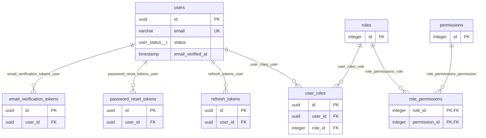
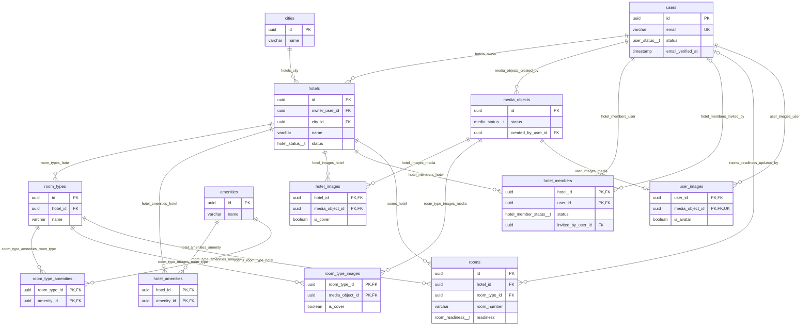
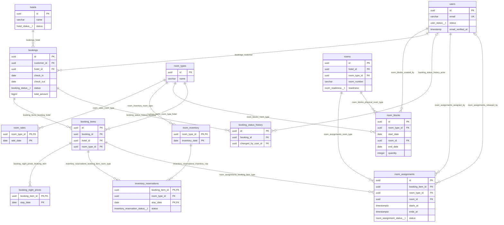
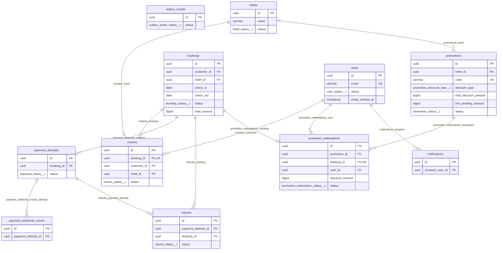

# ERD và quan hệ — Hotel Booking

[Tổng quan](README.md) · [Từ điển](data-dictionary.md) · [Quy tắc](business-rules.md)

Theo DBML mới: **37 bảng, 57 FK**. Bốn vùng sơ đồ hiển thị khóa và một số cột; đủ 300 cột nằm trong từ điển. Bảng ngoài vùng có thể xuất hiện làm điểm nối. Mỗi FK có đúng một dòng trong danh sách ở mục 5; không suy thêm FK cho outbox aggregate_id hoặc refresh token family_id.

Ký hiệu: đúng một `||`, không/một `|o` hoặc `o|`, không/nhiều `o{`. Nullable và UNIQUE quyết định lực lượng quan hệ; FK không buộc cha phải có bản ghi con. PK/UK nhiều cột xem từ điển, không hiểu mỗi cột là duy nhất riêng.

## 1. Identity

## 2. Hotel và Media

## 3. Inventory, Pricing và Booking

## 4. Payment, Review, Promotion và sự kiện

## 5. Đủ 57 khóa ngoại theo nguồn

Hành vi xóa/cập nhật dưới đây được đọc từ `Ref`, không còn là chính sách tự đề xuất của bản docs cũ. Đây là cấu hình DBML, chưa xác nhận đã áp dụng vào PostgreSQL.

| FK | Bảng con(cột) → bảng cha(cột) | Cha/dòng con | Con/cha | ON DELETE | ON UPDATE |
| --- | --- | --- | --- | --- | --- |
| `fk_user_roles_user` | `user_roles(user_id) → users(id)` | 1 | 0..N | NO ACTION | NO ACTION |
| `fk_user_roles_role` | `user_roles(role_id) → roles(id)` | 1 | 0..N | NO ACTION | NO ACTION |
| `fk_role_permissions_role` | `role_permissions(role_id) → roles(id)` | 1 | 0..N | CASCADE | NO ACTION |
| `fk_role_permissions_permission` | `role_permissions(permission_id) → permissions(id)` | 1 | 0..N | CASCADE | NO ACTION |
| `fk_refresh_tokens_user` | `refresh_tokens(user_id) → users(id)` | 1 | 0..N | NO ACTION | NO ACTION |
| `fk_password_reset_tokens_user` | `password_reset_tokens(user_id) → users(id)` | 1 | 0..N | CASCADE | NO ACTION |
| `fk_hotels_owner` | `hotels(owner_user_id) → users(id)` | 1 | 0..N | NO ACTION | NO ACTION |
| `fk_hotels_city` | `hotels(city_id) → cities(id)` | 1 | 0..N | NO ACTION | NO ACTION |
| `fk_room_types_hotel` | `room_types(hotel_id) → hotels(id)` | 1 | 0..N | NO ACTION | NO ACTION |
| `fk_hotel_amenities_hotel` | `hotel_amenities(hotel_id) → hotels(id)` | 1 | 0..N | CASCADE | NO ACTION |
| `fk_hotel_amenities_amenity` | `hotel_amenities(amenity_id) → amenities(id)` | 1 | 0..N | NO ACTION | NO ACTION |
| `fk_room_type_amenities_room_type` | `room_type_amenities(room_type_id) → room_types(id)` | 1 | 0..N | CASCADE | NO ACTION |
| `fk_room_type_amenities_amenity` | `room_type_amenities(amenity_id) → amenities(id)` | 1 | 0..N | NO ACTION | NO ACTION |
| `fk_media_objects_created_by` | `media_objects(created_by_user_id) → users(id)` | 1 | 0..N | RESTRICT | NO ACTION |
| `fk_hotel_images_hotel` | `hotel_images(hotel_id) → hotels(id)` | 1 | 0..N | CASCADE | NO ACTION |
| `fk_hotel_images_media` | `hotel_images(media_object_id) → media_objects(id)` | 1 | 0..N | RESTRICT | NO ACTION |
| `fk_room_type_images_room_type` | `room_type_images(room_type_id) → room_types(id)` | 1 | 0..N | CASCADE | NO ACTION |
| `fk_room_type_images_media` | `room_type_images(media_object_id) → media_objects(id)` | 1 | 0..N | RESTRICT | NO ACTION |
| `fk_hotel_members_hotel` | `hotel_members(hotel_id) → hotels(id)` | 1 | 0..N | CASCADE | NO ACTION |
| `fk_hotel_members_user` | `hotel_members(user_id) → users(id)` | 1 | 0..N | RESTRICT | NO ACTION |
| `fk_hotel_members_invited_by` | `hotel_members(invited_by_user_id) → users(id)` | 0..1 | 0..N | SET NULL | NO ACTION |
| `fk_room_rates_room_type` | `room_rates(room_type_id) → room_types(id)` | 1 | 0..N | CASCADE | NO ACTION |
| `fk_room_inventory_room_type` | `room_inventory(room_type_id) → room_types(id)` | 1 | 0..N | RESTRICT | NO ACTION |
| `fk_room_blocks_room_type` | `room_blocks(room_type_id) → room_types(id)` | 1 | 0..N | RESTRICT | NO ACTION |
| `fk_room_blocks_created_by` | `room_blocks(created_by_user_id) → users(id)` | 1 | 0..N | RESTRICT | NO ACTION |
| `fk_bookings_customer` | `bookings(customer_id) → users(id)` | 1 | 0..N | RESTRICT | NO ACTION |
| `fk_bookings_hotel` | `bookings(hotel_id) → hotels(id)` | 1 | 0..N | RESTRICT | NO ACTION |
| `fk_booking_items_booking_hotel` | `booking_items(booking_id, hotel_id) → bookings(id, hotel_id)` | 1 | 0..N | CASCADE | NO ACTION |
| `fk_booking_items_room_type_hotel` | `booking_items(room_type_id, hotel_id) → room_types(id, hotel_id)` | 1 | 0..N | RESTRICT | NO ACTION |
| `fk_booking_night_prices_booking_item` | `booking_night_prices(booking_item_id) → booking_items(id)` | 1 | 0..N | CASCADE | NO ACTION |
| `fk_inventory_reservations_booking_item_room_type` | `inventory_reservations(booking_item_id, room_type_id) → booking_items(id, room_type_id)` | 1 | 0..N | RESTRICT | NO ACTION |
| `fk_inventory_reservations_inventory_row` | `inventory_reservations(room_type_id, stay_date) → room_inventory(room_type_id, inventory_date)` | 1 | 0..N | RESTRICT | NO ACTION |
| `fk_booking_status_history_booking` | `booking_status_history(booking_id) → bookings(id)` | 1 | 0..N | CASCADE | NO ACTION |
| `fk_booking_status_history_actor` | `booking_status_history(changed_by_user_id) → users(id)` | 0..1 | 0..N | SET NULL | NO ACTION |
| `fk_reviews_booking` | `reviews(booking_id) → bookings(id)` | 1 | 0..1 | RESTRICT | NO ACTION |
| `fk_reviews_customer` | `reviews(customer_id) → users(id)` | 1 | 0..N | RESTRICT | NO ACTION |
| `fk_reviews_hotel` | `reviews(hotel_id) → hotels(id)` | 1 | 0..N | RESTRICT | NO ACTION |
| `fk_payment_attempts_booking` | `payment_attempts(booking_id) → bookings(id)` | 1 | 0..N | RESTRICT | NO ACTION |
| `fk_payment_webhook_events_attempt` | `payment_webhook_events(payment_attempt_id) → payment_attempts(id)` | 0..1 | 0..N | SET NULL | NO ACTION |
| `fk_refunds_payment_attempt` | `refunds(payment_attempt_id) → payment_attempts(id)` | 1 | 0..N | RESTRICT | NO ACTION |
| `fk_refunds_booking` | `refunds(booking_id) → bookings(id)` | 1 | 0..N | RESTRICT | NO ACTION |
| `fk_promotions_hotel` | `promotions(hotel_id) → hotels(id)` | 0..1 | 0..N | SET NULL | NO ACTION |
| `fk_promotion_redemptions_promotion` | `promotion_redemptions(promotion_id) → promotions(id)` | 1 | 0..N | RESTRICT | NO ACTION |
| `fk_promotion_redemptions_booking` | `promotion_redemptions(booking_id) → bookings(id)` | 1 | 0..1 | RESTRICT | NO ACTION |
| `fk_promotion_redemptions_user` | `promotion_redemptions(user_id) → users(id)` | 1 | 0..N | RESTRICT | NO ACTION |
| `fk_notifications_recipient` | `notifications(recipient_user_id) → users(id)` | 1 | 0..N | CASCADE | NO ACTION |
| `fk_rooms_hotel` | `rooms(hotel_id) → hotels(id)` | 1 | 0..N | RESTRICT | NO ACTION |
| `fk_rooms_room_type_hotel` | `rooms(room_type_id, hotel_id) → room_types(id, hotel_id)` | 1 | 0..N | RESTRICT | NO ACTION |
| `fk_rooms_readiness_updated_by` | `rooms(readiness_updated_by) → users(id)` | 0..1 | 0..N | RESTRICT | NO ACTION |
| `fk_room_assignments_booking_item_type` | `room_assignments(booking_item_id, room_type_id) → booking_items(id, room_type_id)` | 1 | 0..N | RESTRICT | NO ACTION |
| `fk_room_assignments_room_type` | `room_assignments(room_id, room_type_id) → rooms(id, room_type_id)` | 1 | 0..N | RESTRICT | NO ACTION |
| `fk_room_assignments_assigned_by` | `room_assignments(assigned_by) → users(id)` | 1 | 0..N | RESTRICT | NO ACTION |
| `fk_room_assignments_released_by` | `room_assignments(released_by) → users(id)` | 0..1 | 0..N | RESTRICT | NO ACTION |
| `fk_email_verification_tokens_user` | `email_verification_tokens(user_id) → users(id)` | 1 | 0..N | CASCADE | NO ACTION |
| `fk_user_images_user` | `user_images(user_id) → users(id)` | 1 | 0..N | CASCADE | NO ACTION |
| `fk_user_images_media` | `user_images(media_object_id) → media_objects(id)` | 1 | 0..1 | RESTRICT | NO ACTION |
| `fk_room_blocks_physical_room_type` | `room_blocks(room_id, room_type_id) → rooms(id, room_type_id)` | 1 | 0..N | RESTRICT | NO ACTION |

## 6. Các FK ghép cần giữ

| Quan hệ | Ý nghĩa |
| --- | --- |
| `booking_items.(booking_id, hotel_id) → bookings.(id, hotel_id)` | Hạng mục thuộc đúng hotel của đơn |
| `booking_items.(room_type_id, hotel_id) → room_types.(id, hotel_id)` | Loại phòng cùng hotel với đơn |
| `inventory_reservations.(booking_item_id, room_type_id) → booking_items.(id, room_type_id)` | Ledger cùng loại phòng với hạng mục |
| `inventory_reservations.(room_type_id, stay_date) → room_inventory.(room_type_id, inventory_date)` | Ledger trỏ đúng dòng tồn/ngày |
| `rooms.(room_type_id, hotel_id) → room_types.(id, hotel_id)` | Phòng vật lý thuộc đúng hotel của loại phòng |
| `room_assignments.(booking_item_id, room_type_id) → booking_items.(id, room_type_id)` | Phân công đúng loại phòng đã mua |
| `room_assignments.(room_id, room_type_id) → rooms.(id, room_type_id)` | Phòng được gán đúng loại; qua room type bảo đảm cùng hotel |
| `room_blocks.(room_id, room_type_id) → rooms.(id, room_type_id)` | Lịch chặn đúng phòng vật lý và loại phòng |

`booking_items` không cần một room_id vì quantity có thể lớn hơn 1. Hai phòng được gán tạo hai room_assignments; một phòng có nhiều phân công qua các kỳ, nhưng các kỳ đang chiếm phòng không được chồng nhau.

## 7. Các quan hệ cần đọc cẩn thận

- `reviews.booking_id` UNIQUE: mỗi booking có tối đa một review.
- `promotion_redemptions.booking_id` UNIQUE: mỗi booking có tối đa một voucher đã áp.
- `user_images.media_object_id` UNIQUE: mỗi media object thuộc tối đa một dòng ảnh tài khoản; một user vẫn có nhiều ảnh.
- `promotions.hotel_id` nullable: không hotel là mã toàn hệ thống. ON DELETE SET NULL hiện tại có rủi ro đổi ý nghĩa mã riêng thành toàn hệ thống khi xóa hotel; xem DB-06 trong README.
- CASCADE xóa liên kết trong DB không tự xóa tệp trên object storage. Chính sách nghiệp vụ vẫn cần giữ lịch sử booking, giao dịch và phân công.

## 8. Những gì FK chưa bảo đảm

FK riêng của review/redemption chưa kiểm tra user/hotel khớp booking; refund chưa kiểm tra booking khớp payment attempt. FK không kiểm tra vai trò, email đã xác minh, trạng thái READY, thời gian voucher, hạn mức, tổng tiền liên bảng, số phân công hoặc chống trùng lịch. Các điều kiện này cần ràng buộc bổ sung hoặc logic giao dịch nhất quán.
