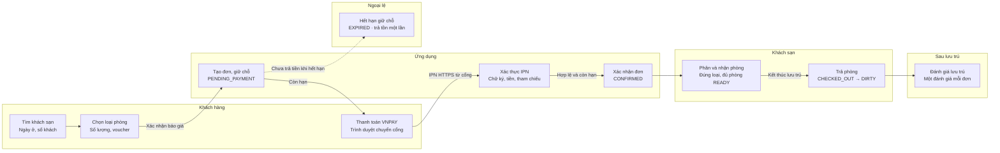
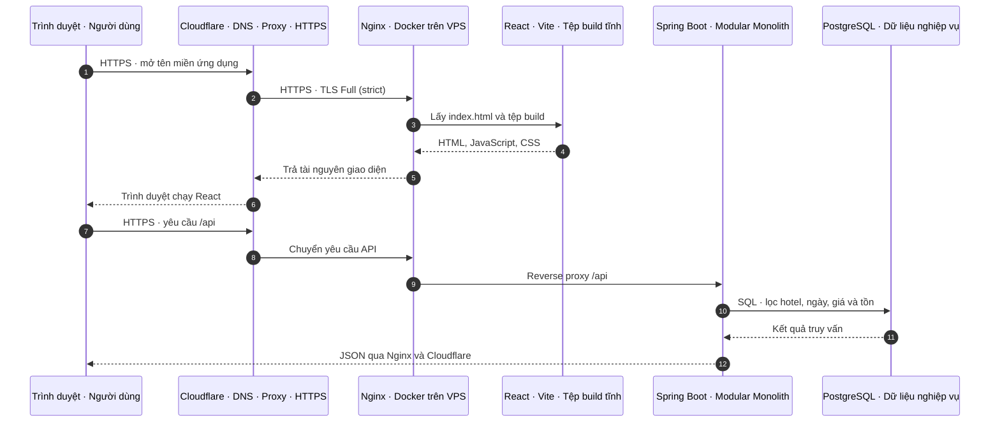
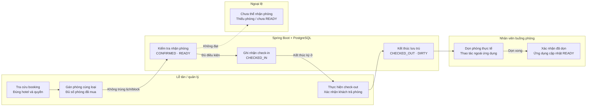
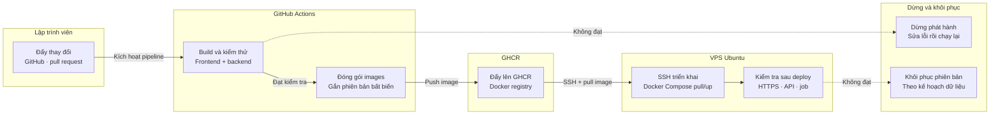

# Sơ đồ luồng hoạt động chi tiết — Hotel Booking

Dựa trên ảnh kiến trúc người dùng gửi và tài liệu nghiệp vụ trong thư mục database. Đây là thiết kế luồng đề xuất, chưa xác nhận mã nguồn/môi trường triển khai.

[Mở mục lục HTML](index.html). Các file PNG, SVG và JSON tương ứng nằm trong flow-diagrams/.

## Hotel Booking · Luồng hoạt động tổng thể



**Đường đi kỹ thuật**

- Trình duyệt → Cloudflare → Nginx → React hoặc /api → Spring Boot.
- PostgreSQL giữ dữ liệu nghiệp vụ; vai trò cụ thể của Redis cần chốt.

**Các nhánh chi tiết**

- Hủy, hoàn tiền, tiền đến muộn và IPN lặp được tách thành sơ đồ riêng.
- Return URL chỉ đưa khách về giao diện; không tự xác nhận đơn.

[HTML](01-tong-quan.html) · [SVG](01-tong-quan.svg) · [PNG](01-tong-quan.png)

## 02 · Truy cập giao diện và tra cứu dữ liệu



**Đọc đúng luồng**

- React chạy trong trình duyệt; Nginx chỉ phục vụ tệp build, không chạy Vite dev server.
- Mũi tên JSON cuối gộp đường trả qua Nginx và Cloudflare để tránh lặp.

**Điều cần cấu hình**

- Cache tài nguyên tĩnh công khai; tránh cache dữ liệu tài khoản, tồn phòng và thanh toán.
- Redis có trong ảnh, nhưng cache/rate limit cụ thể là đề xuất cần chốt; giá và tồn khi đặt phải kiểm tra PostgreSQL.

[HTML](02-truy-cap.html) · [SVG](02-truy-cap.svg) · [PNG](02-truy-cap.png)

## 03 · Đăng ký và xác minh email

```mermaid
sequenceDiagram
    autonumber
    participant web as Trình duyệt · React
    participant api as Spring Boot · Qua Cloudflare/Nginx
    participant pg as PostgreSQL · User · token · outbox
    participant mail as SMTP · Dịch vụ gửi email
    participant inbox as Hộp thư · Khách hàng
    web->>api: Gửi thông tin đăng ký qua /api
    api->>pg: Kiểm tra email; lưu hash mật khẩu
    api->>pg: Lưu token hash có hạn + outbox
    api-->>web: Tài khoản chờ xác minh
    api-->>mail: Tác vụ nền gửi liên kết xác minh
    mail-->>inbox: SMTP chuyển email
    inbox->>web: Khách bấm liên kết HTTPS
    web->>api: Gửi mã xác minh qua /api
    api->>pg: Kiểm tra hash, hạn, đã dùng, thu hồi
    api->>pg: Ghi email_verified_at; dùng token một lần
    api-->>web: Xác minh thành công hoặc lỗi rõ ràng
    web->>api: Đăng nhập để thực hiện đặt phòng
```

**Phạm vi bằng chứng**

- SMTP và hộp thư có trong ảnh; token và outbox lấy từ tài liệu nghiệp vụ.
- Tác vụ nền là phần xử lý nội bộ được đề xuất, không thêm một container worker vào ảnh gốc.

**Nhánh lỗi và bảo vệ**

- Token hết hạn/đã dùng/bị thu hồi: từ chối, cho yêu cầu mã mới theo chính sách.
- Đặt lại mật khẩu dùng token riêng; database chỉ lưu hash. email_verified_at cần cho phép NULL trước xác minh.

[HTML](03-tai-khoan-email.html) · [SVG](03-tai-khoan-email.svg) · [PNG](03-tai-khoan-email.png)

## 04 · Báo giá, tạo booking và giữ chỗ

```mermaid
sequenceDiagram
    autonumber
    participant web as Trình duyệt · Khách đã xác minh email
    participant api as Spring Boot · Qua Cloudflare/Nginx
    participant pg as PostgreSQL · Transaction và lịch phòng
    participant job as Tác vụ hết hạn · Đề xuất trong backend
    web->>api: Chọn ngày, loại phòng, số lượng, voucher
    api->>pg: Đọc giá từng đêm và điều kiện voucher
    api-->>web: Báo giá trọn gói trước/sau giảm
    web->>api: Xác nhận giá; gửi khóa chống tạo trùng
    api->>pg: BEGIN · kiểm tra user/quyền, khóa tồn
    pg-->>api: Đủ phòng liên tục và đủ hạn mức voucher
    api->>pg: Lưu booking, items và snapshot từng đêm
    api->>pg: HELD + expires_at; giữ lượt voucher
    api->>pg: COMMIT · tổng tiền và outbox nhất quán
    api-->>web: PENDING_PAYMENT + mã đơn + hạn giữ
    job->>pg: Đến hạn: khóa và đọc lại đơn chưa trả tiền
    job->>pg: EXPIRED; RELEASED tồn/lượt đúng một lần
```

**Một giao dịch nhất quán**

- Tổng tiền = số lượng × tổng giá các đêm, trừ tối đa một voucher.
- Kiểm tra lại trong transaction; không tin báo giá cũ hoặc cache Redis để quyết định còn phòng.

**Điều kiện và ngoại lệ**

- Thiếu giá/phòng, voucher sai hoặc giá đổi: trả lỗi và để khách xác nhận lại.
- 15 phút giữ chỗ là đề xuất chưa chốt. Retry thanh toán không tự kéo dài hạn; khóa chống tạo trùng cần bổ sung khi triển khai.

[HTML](04-tao-booking.html) · [SVG](04-tao-booking.svg) · [PNG](04-tao-booking.png)

## 05 · Thanh toán VNPAY và xác nhận bằng IPN

```mermaid
sequenceDiagram
    autonumber
    participant web as Trình duyệt · React
    participant api as Spring Boot · Kiểm tra giao dịch
    participant pg as PostgreSQL · Booking và payment
    participant vnpay as VNPAY · Cổng thanh toán
    web->>api: Yêu cầu thanh toán qua /api
    api->>pg: Đọc đơn còn hạn; tạo payment_attempt
    api-->>web: URL VNPAY đã ký, tiền sau voucher
    web->>vnpay: HTTPS · khách thực hiện thanh toán
    vnpay-->>web: Return URL về ứng dụng
    web->>api: Đọc trạng thái; có thể còn đang xử lý
    vnpay-->>api: IPN HTTPS qua Cloudflare và Nginx
    api->>pg: Chỉ sau xác thực: khóa đơn, chống lặp
    pg-->>api: Đối chiếu đơn, tiền, currency, tham chiếu
    api->>pg: SUCCEEDED; CONFIRMED; HELD → CONFIRMED
    api->>pg: Ghi lịch sử, thông báo/outbox; COMMIT
    api-->>vnpay: Trả mã phản hồi IPN theo hợp đồng
    web->>api: Lấy lại trạng thái đơn từ server
    api-->>web: Hiển thị CONFIRMED khi server xác nhận
```

**Hai đường độc lập**

- Ví dụ minh họa Return URL đến trước IPN; thứ tự thực tế có thể đảo hoặc IPN được gửi lại.
- Phải xác thực chữ ký/tham số trước mọi tác động nghiệp vụ. Trang trình duyệt báo thành công chưa đủ để xác nhận đơn.

**Nhánh phải xử lý**

- Sai chữ ký, tiền hoặc tham chiếu: không xác nhận. IPN lặp: không thu/trừ tồn lần hai.
- Tiền đến sau hủy/hết hạn: ghi nhận và xử lý hoàn, không hồi sinh đơn. Timeout chưa đồng nghĩa FAILED; giao thức/mã phản hồi chi tiết phải chốt theo VNPAY.

[HTML](05-thanh-toan.html) · [SVG](05-thanh-toan.svg) · [PNG](05-thanh-toan.png)

## 06 · Hủy đơn và hoàn tiền theo khoản thực thu

```mermaid
sequenceDiagram
    autonumber
    participant actor as Người yêu cầu · Khách / nhân sự có quyền
    participant api as Spring Boot · Chính sách đã lưu
    participant pg as PostgreSQL · Booking · payment · refund
    participant vnpay as VNPAY · Tra cứu / hoàn tiền
    actor->>api: Yêu cầu hủy đơn và lý do qua /api
    api->>pg: Kiểm tra người, hotel, trạng thái, chính sách
    pg-->>api: Khoản thực thu và hạn mức hoàn còn lại
    api->>pg: Khóa đơn; CANCELLED; trả phần tồn hợp lệ
    api-->>actor: Đã hủy; tiền hoàn có trạng thái riêng
    api->>pg: Nếu được hoàn: tạo refund chống lặp
    api->>vnpay: Gửi yêu cầu hoàn đúng giao dịch gốc
    vnpay-->>api: Kết quả hoàn hoặc đang xử lý
    api->>vnpay: Nếu chưa rõ kết quả: tra cứu, không hoàn lại
    api->>pg: Cập nhật refund theo kết quả xác thực
    api->>pg: Lưu lịch sử và thông báo/outbox
    api-->>actor: Hiển thị khoản hoàn và trạng thái cuối
```

**Số tiền và điều kiện**

- Luồng hoàn chỉ chạy khi có khoản thu và chính sách cho phép; hủy trước thanh toán không cần gọi hoàn.
- Tổng hoàn thành công + đang yêu cầu không vượt thực thu sau voucher; refund phải thuộc đúng booking/payment.

**Ngoại lệ độc lập**

- Hết hạn: tác vụ nền giải phóng giữ chỗ đúng một lần. Tiền đến muộn chuyển sang xử lý hoàn phù hợp.
- CANCELLED không có nghĩa đã hoàn tiền. Chính sách hủy, mức hoàn và trả lượt voucher sau thanh toán cần chốt.

[HTML](06-huy-hoan.html) · [SVG](06-huy-hoan.svg) · [PNG](06-huy-hoan.png)

## 07 · Nhận phòng, trả phòng và phục hồi phòng sẵn sàng



**Phân phòng và tồn kho**

- Khách đặt loại phòng, lễ tân mới gán phòng cụ thể; quantity = 2 cần hai phòng khác nhau.
- Gán/đổi phòng giữ lịch sử, không bán/trừ tồn hoặc thu tiền lần hai. Phòng có thể được gán từ trước check-in.

**Khách không đến và bảo trì**

- CONFIRMED → NO_SHOW chỉ khi nhân viên xác nhận đủ điều kiện và không có báo đến muộn còn hiệu lực.
- No-show trả phần tồn chưa dùng, không thu thêm/hoàn theo chính sách hiện có. Chặn bảo trì không được làm mất chỗ của đơn đã nhận; hết block không tự READY.

[HTML](07-van-hanh.html) · [SVG](07-van-hanh.svg) · [PNG](07-van-hanh.png)

## 08 · Tải ảnh lên Cloudflare R2

```mermaid
sequenceDiagram
    autonumber
    participant web as Trình duyệt · Chủ hotel / người dùng
    participant api as Spring Boot · Qua Cloudflare/Nginx
    participant pg as PostgreSQL · Media và liên kết ảnh
    participant r2 as Cloudflare R2 · Object storage
    web->>api: Yêu cầu tải ảnh và metadata qua /api
    api->>pg: Kiểm tra quyền; tạo media PENDING
    api->>r2: S3 API · chuẩn bị URL tải có hạn
    api-->>web: URL ký trước và object key được phép
    web->>r2: HTTPS PUT · tải ảnh trực tiếp
    r2-->>web: Kết quả upload
    web->>api: Yêu cầu hoàn tất media
    api->>r2: S3 API · kiểm tra object thực tồn tại
    r2-->>api: Metadata object: loại và kích thước
    api->>pg: Kiểm tra nội dung; READY và liên kết ảnh
    api-->>web: URL phân phối ảnh theo chính sách
    web->>r2: HTTPS GET · đọc ảnh được phép
```

**Phương án đề xuất từ ảnh**

- Ảnh gốc có trình duyệt tải ảnh và backend dùng S3 API; URL ký trước là phương án triển khai đề xuất.
- Bước chuẩn bị URL được ký bằng S3 client; không bắt buộc gửi một request mạng đến R2 để tạo chữ ký.

**Ràng buộc media**

- Không cấp khóa S3 cho trình duyệt; URL ký trước có hạn, giới hạn object và quyền thao tác.
- Chưa kiểm tra xong giữ PENDING, không tự READY theo lời client. Một cover/hotel, cover/loại phòng, avatar/user; không lưu URL ký trước làm địa chỉ lâu dài.

[HTML](08-tai-anh.html) · [SVG](08-tai-anh.svg) · [PNG](08-tai-anh.png)

## 09 · CI/CD từ GitHub đến VPS Ubuntu



**Theo kiến trúc gốc**

- GitHub / GitHub Actions / GHCR → SSH → VPS Ubuntu chạy Docker Compose.
- Nginx phục vụ React build và proxy /api; Spring Boot nối PostgreSQL/Redis trên mạng Docker nội bộ.

**Bước triển khai đề xuất**

- Cổng kiểm thử, image bất biến, backup trước migration, health check và rollback là chi tiết cần triển khai/chốt.
- PostgreSQL dùng persistent volume; rollback image không tự rollback schema. Persistent volume không thay thế backup.

[HTML](09-trien-khai.html) · [SVG](09-trien-khai.svg) · [PNG](09-trien-khai.png)

## Nguồn và giả định


Các sơ đồ là thiết kế luồng đề xuất, không phải bằng chứng hệ thống đã triển khai.

- Kiến trúc theo ảnh người dùng gửi: Cloudflare DNS/Proxy/HTTPS; VPS Ubuntu và Docker Compose; Nginx phục vụ React/Vite và reverse proxy /api; Spring Boot Modular Monolith; PostgreSQL persistent volume; Redis; Cloudflare R2; SMTP; VNPAY; GitHub Actions và GHCR.
- Quy tắc nghiệp vụ lấy từ business-rules.md, data-dictionary.md và README.md trong thư mục database.
- Các bước còn là đề xuất được đánh dấu ở thẻ ghi chú: vai trò Redis, URL ký trước R2, outbox/tác vụ nền, chính sách giữ/hủy/hoàn, lịch job, API và pipeline chi tiết.
- Không xác định endpoint nghiệp vụ cụ thể khi chưa có hợp đồng API; chỉ giữ đường /api được ghi trên ảnh.
- IPN được xác thực và xử lý chống lặp; Return URL không phải bằng chứng thanh toán. Hai đường có thứ tự độc lập.
- PostgreSQL là nguồn dữ liệu bền vững cho booking/tồn/tiền. Redis không thay thế transaction và kiểm tra tồn ở DB.
- Việc ký URL bằng S3 client không nhất thiết phát sinh một request đến R2; mũi tên đó thể hiện quan hệ sử dụng S3 API/client.
- Nội dung tác giả viết bằng tiếng Việt có dấu. Thanh công cụ cố định và thuộc tính html lang của trình xem Archify dùng tiếng Anh do chưa hỗ trợ tiếng Việt.


